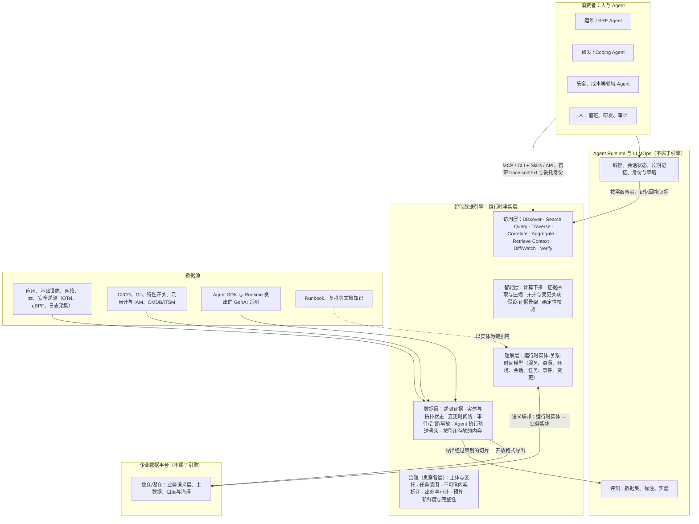

# 为 Agent 供给可验证的运行时事实：Agent 时代智能数据引擎研究

> **研究说明 / 方法与局限**（研究截止：2026-09-30）
>
> 本文写给负责企业日志与可观测平台的团队，属于方向研究，基于公开资料的桌面研究，覆盖标准规范、厂商文档与开源仓库、学术论文与公开基准、行业分析与实践文章。有三点局限需先说明。**第一**，本研究的参考起点是阿里云关于"Agent 时代智能数据引擎 / 运行时数据智能"的一篇微信文章 [79]。研究期间该文章无法访问，也未找到镜像或转载，因此本文**不重建其内容**。文中对阿里云方向的刻画完全来自其他官方来源：SLS 文档与案例仓库、STAROps、UModel、云监控 2.0、可观测 MCP Server 等。**第二**，大量厂商页面只能通过搜索引擎摘要获取，没有读到全文，涉及阿里云帮助中心、Grafana、Elastic、Dynatrace、Splunk、Snowflake、Databricks、ClickHouse 等。这些页面中的数字与引文需要复核，参考文献中已逐条注明"经搜索摘要获取"。**第三**，若干对方向判断很关键的数据在公开资料中缺失，最典型的是日志/可观测平台上 Agent 与人类查询的占比。
>
> **标注约定**：[n] 对应第 10 节参考文献，各类标签含义如下。
> - **【事实】**：技术事实或标准规范，可在规范、官方文档或开源代码中核对。
> - **【定位】**：厂商对产品方向与角色的表述。
> - **【宣传】**：厂商宣传，或厂商自报、自测的数字（准确率、MTTR、成本等），未经独立验证。
> - **【学术】**：学术论文或公开基准结果。
> - **【观点】**：第三方分析师、媒体或从业者的观点。
> - **【判断】**：本文的分析判断。
> - **·待核实**（后缀）：该数字或引文仅见于搜索摘要、二手转述，或原文无法取回，引用前需复核。
>
> 证据强度分三档：**强**表示有多个独立来源或可核对的一手资料；**中**表示一手资料有限，或来源类型单一；**弱**表示主要来自厂商宣传、摘要或推断。

## 1. Executive Summary

1. **Agent 改变的是数据的"消费契约"：它需要可发现、语义清晰、结果有界、带时间与出处、可确定性复核的事实，而不是仪表盘与原始结果集。** 新鲜度提示、确定性排序与 trace context 传递已经写入 MCP 协议。（证据强度：强 [1, 22, 23]）
2. **在运维任务上，数据侧的确定性工作（实体归一、异常压缩、证据抽取、系统描述）是目前可测量的最大杠杆之一，但推理与验证失败依然存在。** 一份简短的系统描述即可带来 +7～+18 个 top@1 点；EviRCA 报告把证据抽取移出模型后准确率约提升 3 倍、token 减少 15–26 倍（待核实）。（证据强度：中，多来自离线、故障注入式基准 [122, 123, 125]）
3. **可观测行业已集体转向"为 Agent 供给上下文"（托管 MCP 与 Skills、实体图 grounding、假设-证据树、主动调查、按调用/扫描/token 计量），但效果证据远弱于模式证据。** MTTR 与准确率数字均为厂商自报，而独立基准 ITBench-AA 上所有前沿模型仍低于 50%。（模式证据：强；效果证据：弱 [53, 71, 124]）
4. **"日志系统成为企业 Agent 数据底座"这一假设不成立：数仓/湖仓正在吸收可观测与 Agent 轨迹并掌握业务语义，Agent Runtime 掌握会话与记忆，LLMOps 工具掌握评测数据集。** 代表事件包括 ClickHouse 收购 HyperDX 与 Langfuse、Snowflake 收购 Observe、Databricks 推出 Lakewatch 并把 MLflow traces 写入 Unity Catalog。（证据强度：强，个别金额待核实 [97, 103, 108]）
5. **日志/可观测平台最适合占据企业 Agent 数据体系中的"运行时事实层"：实时遥测证据、运行时实体与拓扑、跨系统变更时间线、事故与调查证据、Agent 执行轨迹骨架与审计。** 建议以 Observability Data Intelligence 为能力内核，对外定位为"运行时事实引擎"（可沿用"智能数据引擎"之名，但限定于运行时），业务语义联邦接入而非自建。（证据强度：中，本文判断）
6. **数据智能与模型智能的分界是：凡能确定性、可复现、可审计完成的步骤（检索裁剪、聚合、异常检测、实体解析、拓扑遍历、时间对齐、证据指纹与复核）都应下沉到数据平台，假设取舍、跨域推理与行动决策留给模型。** 两者的接口是带出处的证据卡与假设-证据树；Datadog 的工程教训与阿里云的"计算下推"原则指向同一方向。（证据强度：中 [52, 87]）
7. **治理是新增量而非 RBAC 的延伸：Agent 主体与委托链、任务级数据范围、把日志内容视为不可信指令通道、决策级溯源、按任务预算、机器可读的新鲜度与完整性元数据。** 研究显示云厂商的提示注入防护对日志内嵌载荷几乎无效（待核实），而面向 Agent 的新鲜度元数据目前没有任何标准。（证据强度：中—强 [5, 15, 138]）
8. **最能证明平台价值的是变更感知的故障诊断与值班、变更风险评估、长时/多 Agent 运维协作；安全调查与研发 Agent 属于有条件场景，巡检与容量/成本属于支撑场景。** 推进应以"同一 Agent、同一模型、只换数据层"的对照 PoC 作为关口。（证据强度：中 [117, 126, 128]）
9. **阿里云的方向（SLS 计算下推 + UModel 实体语义 + MCP/Skills + STAROps/AgentLoop）是"运行时数据智能"最完整的公开样本之一，但核心证据为自建自评。** 其报告 UModel 语义工具使开源 Agent 得分提升约 49%、STAROps 以 75.23 对 51.02 领先，尚无独立复现；锚点文章的内容也未能核实。（证据强度：中偏弱 [82]）

## 2. 为什么 Agent 会改变数据基础设施

### 2.1 从"人查询数据"到"Agent 消费事实"

人使用日志与可观测平台的方式，是扫一眼仪表盘、凭经验忽略噪声，需要时再查。Agent 的方式完全不同。Anthropic 把 Agent 循环概括为 "gather context → take action → verify work → repeat"【事实】[31]，并指出模型拥有有限的 "attention budget"：上下文越长，模型准确回忆信息的能力越差【事实】[22]。Chroma 的 Context Rot 报告也发现，即便是简单任务，输入长度变化也会让模型表现明显波动【学术】[134]。结论是：数据平台每多返回一个无关 token，都在同时消耗 Agent 的推理质量和成本。

一线工程经验把这一点具体化了：

- Claude Code 默认把工具返回限制在 25,000 tokens，建议用分页、范围选择、过滤与截断控制返回量；还建议不要返回 uuid 这类低层标识符，把它们解析为有语义的名称能"significantly improves"检索精度【事实】[23]。
- 在代码中先过滤再返回，一个工作流的消耗从 150,000 tokens 降到 2,000 tokens【事实】[24]。
- 5 个 MCP Server 的 58 个工具，仅定义本身就占约 55K tokens；改为按需发现工具后，Opus 4 的准确率从 49% 升到 74%【事实】[25]。

协议层也在同步演进。MCP 2026-07-28 版本有以下变化【事实】[1, 2]：

- 协议改为无状态，跨调用的状态通过服务端签发的句柄传递。
- list/read 结果要携带新鲜度提示 `ttlMs` 与 `cacheScope`。
- 工具列表应按确定性顺序返回，以提高 prompt 缓存命中率。
- 可以在 `_meta` 中传递 OpenTelemetry 的 `traceparent`。
- 资源注解包含 `lastModified`。

新鲜度、确定性、可追踪性正在从可选功能变成"接口级"要求。确定性的价值还体现在成本上：Manus 称 KV 缓存命中率是生产级 Agent "最重要的单一指标"，其输入与输出 token 之比约为 100:1，哪怕只差一个 token 也会让缓存失效【观点·待核实】[157]。对数据平台来说，这意味着同一查询应返回顺序稳定、序列化一致的结果【判断】。

验证是最容易被低估的一点。Anthropic 发现，让 Agent 评价自己的产出时，它往往 "confidently praising the work"，把做事和评判拆开才有效【事实】[28]。dbt Labs 在 2026 年基准复测中强调，语义层的关键性质是 "When it can't, it tells you. It never silently returns wrong data"，而 Text-to-SQL "will cheerfully give you a wrong number"【定位】[113]。在多步自主执行中，未被发现的错误会沿着循环累积，所以对 Agent 来说，"知道自己不知道"（校准的拒答）比平均准确率更重要【判断】。

综上，Agent 对数据层提出了七项新要求【判断】：

1. **可发现**：能渐进地知道有哪些数据、字段、实体与工具。
2. **可理解**：拿到的是语义，而不是原始 schema 与 ID。
3. **有边界**：结果预算按 token 而不是字节计算，并提供分页和"再取更多"的句柄。
4. **带时间**：提供新鲜度、有效期和时间点一致性。
5. **带出处**：每个事实都能回溯到数据源和查询。
6. **可复核**：支持确定性重放、结构化输出和校准拒答。
7. **适配高扇出的小查询**：能承受大量并行、探索式、幂等的读取。

### 2.2 Agent 在任务中需要哪些数据与上下文

各框架和协议对上下文的划分方式不同，但大体可以收敛为几类【判断】。需要说明，跨厂商并无统一术语，"Real-time Context"与"Runtime Data"的边界尤其没有权威定义。几个有代表性的划分如下：

- LangChain 把上下文工程策略概括为 write / select / compress / isolate【观点】[158]。
- Anthropic 主张 "just in time"：Agent 只保留文件路径、存储查询这类轻量标识符，运行时再用工具加载数据【事实】[22]。
- Google ADK 明确区分三者：Session 是事件序列，State 只属于当前会话，Memory 是跨会话、可搜索的知识库【事实】[35]。
- Anthropic Managed Agents 把 session 定义为一个 "lives outside Claude's context window" 的持久事件日志，可以按位置切片查询，也可以从最后一个事件恢复【事实】[29]。

| 上下文类型 | 内容 | Agent 为什么需要 | 天然所有者 | 与日志/可观测的关系 |
|---|---|---|---|---|
| Runtime Data（运行时事实） | 日志、指标、链路、事件、拓扑、配置与变更 | 回答"系统此刻或彼时实际发生了什么"，是行动与验证的依据 | 遥测与运行时系统 | 核心资产 |
| Agent Runtime Data | 会话、任务、Agent 调用、模型/工具/MCP 调用、记忆操作、评测事件、token | 审计、成本、失败分析，以及回流为后续上下文 | 遥测骨架可归可观测平台；状态归 Runtime | 新增数据域 |
| Real-time Context | 正在变化的状态、告警、变更通知、新鲜度 | 判断事实是否仍然成立、何时需要重取 | 流式系统、事件总线 | 强相关（流式检测、订阅） |
| Session / Task / Execution Context | 会话事件、计划、待办、中间结果句柄 | 让长任务可恢复、多步保持一致、可交接 | Agent Runtime / Harness | 可观测其骨架，不拥有其状态 |
| Operational Data | CMDB、工单、Runbook、所有权、事故与复盘 | 把事实映射到责任、流程与历史经验 | ITSM、CMDB、知识库 | 可关联，事故与调查证据可部分拥有 |
| Semantic Layer / 知识层 | 实体、关系、指标定义、单位、时间语义、系统描述 | 消歧、降低探索成本、支持"无法回答" | 业务语义在数据平台；运行时语义尚无主 | 运行时实体语义是机会所在 |
| Memory | 工作记忆、长期偏好、经验与剧本 | 跨会话复用结论与经验 | Agent Runtime、记忆服务 | 应指向事实，而不是替代事实 |
| Context Engineering | 对以上内容做选择、压缩、隔离、组装的方法 | 在注意力预算内放入"最小充分集" | 以 Harness 为主 | 数据平台提供下推、裁剪、句柄等原语 |

表中最后一行不是一种数据，而是一门工程纪律。把它列进来，是为了说明数据平台的职责：提供可以被组装的原语，而不是替 Agent 完成全部组装【判断】。

### 2.3 Agent Memory 不是事实数据

记忆系统自己的设计已经承认了这条边界，但各家的处理方式不同：

- Zep/Graphiti 把原始数据称为 "the ground truth stream"。每条派生事实都有有效期窗口，并能追溯到原始 episode；信息变化时，旧事实是"被失效"而不是被删除【事实】[48]。
- Vertex AI Memory Bank 在写入时由 Gemini 合并新旧记忆并 "resolving contradictions"【定位】[34]。
- Mem0 在 2026 年的新算法正好相反：只追加、不覆盖，并且把"Agent 生成的事实"与观察到的事实同等对待【宣传】[49]。

相关风险也已经有明确证据：

- 微软 AI Red Team 把记忆投毒列为 Agent 特有的隐患，建议对记忆写入做外部认证与校验【定位】[40]。
- 有研究发现 Agent 存在 "experience-following" 行为，低质量记忆会导致错误传播【学术·待核实】[137]。
- ACE 发现，反复改写上下文会出现 brevity bias 和 context collapse【学术】[135]。

本文的划分是【判断】：**记忆**是 Agent 所相信的主张，它是派生的、有作用范围、会过期、带置信度，并且应当指向证据；**事实**是权威系统中可以重新查询、重新复核的记录。这对数据引擎有三点含义：

1. 记忆条目应当携带源句柄、观察时间、有效期、派生方式和作者（人 / Agent / 系统），这样任何 Agent 在行动前都能回到源头重新核对。
2. 底层存储宜采用追加写加双时态，才能审计"Agent 做决定时知道什么"，并支持时间回溯。
3. 必须区分"观察到的事实"与"Agent 推断的结论"，否则像 Mem0 那样把 Agent 生成的事实当作一等公民，会把错误放大。

记忆的热路径（低延迟检索、用户级隔离、合并与删除语义）应当留在 Agent Runtime。数据引擎提供的是记忆可以回指的事实底座。

### 2.4 主动探索、查询、验证与关联

Agent 越来越多地是在"探索"，而不是"一次提问"。Anthropic 描述的 progressive disclosure 让 Agent 通过探索逐步发现相关上下文。它还建议先用 grep/tail 这类 agentic search，只有需要速度时才引入语义检索，因为语义检索 "less accurate, more difficult to maintain, and less transparent"【事实】[22, 31]。

基准的演变也印证了这一点：

- Spider 2.0 已转向 Agent 设定，GPT-4 在其企业级任务上只解决了 6.0%【学术】[131]。
- BIRD-Interact 一次评测会触发 1,968–5,496 轮交互，最好的模型在主动模式下也只有约 18%【学术】[132]。
- OpenRCA 的基线 Agent 用 Python 取数与分析，目的是"避免处理过长上下文"【学术】[119]。
- AIOpsLab 让 Agent 通过 `get_logs`、`get_metrics`、`exec_shell` 等受控接口与环境交互，并承认存在 "data overload"【学术】[130]。

最有说服力的是厂商自己的教训。Datadog 在构建 Bits AI SRE 时发现，早期版本先发出大量工具调用、再统一汇总，结果效果反而下降。新版本 "focuses on the causal relationship between the monitor alert and specific telemetry data pertaining to a hypothesis, rather than looking at all of the available telemetry data at once"【事实】[52]。换言之，Agent 需要的是以假设为范围的定向取证，而不是更大的检索面。

据此，主动探索对数据层提出了一个五步链条【判断】：

1. **Discover**：以低成本浏览元数据、实体与字段，并附带描述与新鲜度。
2. **Understand**：获得语义定义、取值分布和已知的关联路径。
3. **Probe**：做带误差界的采样与近似查询，执行前先估计成本。
4. **Correlate**：按实体与时间跨信号关联。这一步不可省，OpenRCA 指出网络类故障仅凭 KPI 往往无法识别【学术】[119]。
5. **Verify**：确定性重跑，保证会话级快照一致，并能做校准拒答。

另外，探索会让查询成本变得不可预测，因此需要按任务设置预算，超限时返回可行动的提示，而不是直接硬失败。

### 2.5 Agent 产出的数据成为后续 Agent 的上下文

Agent 的轨迹、决策与结论正在变成新的数据资产：

- **学术研究**：ReasoningBank 同时从成功和失败的轨迹中学习推理记忆【学术】[136]；ACE 把上下文当作 "evolving playbooks"，利用自然的执行反馈迭代【学术】[135]。
- **工程实践**：Anthropic 的长时 Agent 依靠进度文件、JSON 特性清单和 git 历史，让后续会话能快速了解工作状态；子 Agent 把产出写到外部系统，只向协调者传回轻量引用【事实】[26, 27]。
- **LLMOps 工具**：LangSmith 的 trace 保留 180 天，而从 trace 提炼出的数据集 "persist indefinitely"【事实】[46]。
- **失败分析**：MAST 发布了逾千条带标注的多 Agent 轨迹，并用它们解释 ITBench SRE 任务的失败模式【学术】[125]。

在共享粒度上存在真实的分歧：Cognition 主张 "share full agent traces"【观点】[156]，A2A 则刻意保持 Agent 之间的 "Opaque Execution"，只交换 Artifact【事实】[7]。

本文判断如下【判断】。Agent 执行数据同时具有遥测和知识两种属性：像遥测一样高频、时序化、呈 trace 结构，又像知识一样承载决策、结论和剧本。对运行时事实引擎而言，它首先是一类可以通过 trace context 与系统遥测关联起来的数据，可以回答"过去哪些事故调查触达过这个服务、检验过哪些假设、哪些被证实"。同时，它进入检索时必须带着结果标签和验证状态，否则会把错误经验放大。在信任边界之内可以共享完整轨迹；跨组织或跨厂商时，则交换带出处的类型化工件。

### 2.6 为什么单一的日志、可观测、数仓、搜索或 RAG 都不够

| 系统 | 擅长 | 面向 Agent 缺什么 | 证据 |
|---|---|---|---|
| 日志平台 | 全量原始证据、全文检索、实时写入 | 数据量大而结构弱；缺实体与跨信号关联；结果不以 token 为界 | OpenRCA 专用 Agent 最佳仅 11.34%【学术·待核实】[119]；一个 30 分钟窗口约 2 GB【学术·待核实】[121] |
| 可观测平台（APM/指标） | 服务拓扑、黄金指标、告警 | 拓扑与语义多为 UI 服务；存在厂商"数据墙"；图谱易过时 | 厂商的 "data wall"【观点·待核实】[155]；"the graph becomes outdated almost instantly"【观点·待核实】[153] |
| 数仓/湖仓 | 业务语义、治理、历史分析 | 原始 schema 对 Agent 语义不足；实时性与流式检测是短板 | Spider 2.0 上 GPT-4 仅 6.0%【学术】[131]；Lakehouse//RT 在 2026 年才进入 Beta【事实·待核实】[111] |
| 搜索、向量检索、RAG | 非结构化文本召回 | 多跳关联、整体聚合、时态变化与精确性弱；新鲜度与出处不足 | "Baseline RAG struggles to connect the dots"【定位】[41]；语义检索比 agentic search 更不准确、更不透明【事实】[31] |

反证同样需要正视：

- **模型进步很快。** dbt 复测显示，对原始 schema 的 Text-to-SQL 准确率从 2023 年的 32.7% 升至 2026 年的 64.5%；在建模良好的表上达到 84–90%，语义层只再多出 8–16 个点【宣传】[113]。
- **通用 Agent 已有不错表现。** 在 SREGym 的应用层故障上，通用编码 Agent 取得最好的端到端成绩，为 60.7%【学术·待核实】[126]。
- **瓶颈可能在推理。** 有研究认为，在绝大多数失败案例中 "the required evidence is present"，瓶颈在推理而不在数据访问【学术·待核实】[121]。

本文判断【判断】：这些系统都没有"错"，只是各自缺少 Agent 所需契约的一部分。真正的缺口更像是一层面向 Agent 的访问与理解层，它要做到语义化、可探索、可验证、带出处，而不是再加一个存储。这层能力在数据碎片化、体量巨大、随时间变化的场景中价值最大；在单一厂商、数据已统一的场景中价值最小。

### 2.7 "Agent 可消费的数据"与"人可查询的数据"

| 维度 | 人可查询的数据 | Agent 可消费的数据 |
|---|---|---|
| 发现 | 靠经验、文档、仪表盘目录 | 可编程发现：数据集、字段、实体与工具的目录和描述，渐进披露 |
| 语义 | 人脑补全字段含义与命名差异 | 显式的实体、关系、单位、时间语义；跨源同一实体归一 |
| 结果形态 | 图表与大结果集，由人自己扫读 | 有界、排序、结构化；按 token 设预算，提供分页与句柄 |
| 时间 | 时间选择器、UI 上的延迟提示 | 机器可读的新鲜度、有效期、完整性与采样标记 |
| 可信度 | 凭经验判断 | 带出处与置信度；无法回答时明确拒答 |
| 可复核 | 把链接分享给同事 | 规范化查询 + 时间窗 + 结果指纹，可确定性重放 |
| 调用模式 | 少量交互式查询 | 大量小查询，并行扇出，事故期突发，后台自主运行 |
| 错误处理 | 报错后由人来修 | 返回可行动的错误提示，支持自我纠正 |
| 身份与权限 | 用户 / 角色 | Agent 主体 + 委托用户 + 客户端；任务级、临时、最小范围 |
| 内容信任 | 人能识别恶意文本 | 日志字段可能是攻击者注入的指令，需要标注为不可信 |
| 审计 | 谁调用了哪个 API | 哪些数据支撑了哪个结论与行动 |
| 成本单位 | CPU、扫描字节、存储 | 在此基础上加上返回 token、工具调用次数、每任务预算 |

表中右列的依据分别来自工具设计指南、MCP 协议演进、Datadog MCP Server 的治理实践与日志注入研究 [1, 23, 54, 138]，整张对照是本文的归纳【判断】。

### 2.8 负载、交互与治理模型的变化

**负载模型。** 已有的一手数据来自模型厂商和 Agent 产品：

- Anthropic 测得 Agent 的 token 消耗约为普通对话的 4 倍，多 Agent 系统约为 15 倍；主 Agent 会并行拉起 3–5 个子 Agent，子 Agent 再并行调用 3 个以上工具【事实】[26]。
- Claude Code 单轮自主运行时长的第 99.9 百分位，在三个多月里从不到 25 分钟升到 45 分钟以上【事实】[30]。

数据平台侧的数字多为厂商自述：

- ClickHouse 称每个"感知-思考-行动"循环会发出 5–20 条 SQL【宣传·待核实】[101]。
- Cleric 报告一次告警调查常常需要 50 次以上查询，并会触及限流【宣传·待核实】[153]。
- Datadog 在财报材料中称，MCP 工具调用量季度环比增长到原来的 4 倍【宣传·待核实】[59]。
- Databricks 称 Neon 上超过 80% 的数据库由 Agent 创建【宣传·待核实】[110]。

**目前没有任何公开数据给出日志/可观测平台上 Agent 与人类查询的占比。** 本文的判断是【判断】：负载将从人节奏的稀疏交互，变为扇出形、突发、长时的形态；而且突发往往与事故时刻重合，恰好是平台本已承压的时候。系统的约束也会从扫描吞吐量，转向每次调用返回的 token 数。

**交互模型。** 查询正在变成持久任务中的一个步骤：

- A2A 以 "Async First" 为原则设计长时任务【事实】[7]。
- MCP 把长任务做成带轮询的官方扩展，并用无状态协议加服务端句柄支持水平扩展【事实】[1, 4]。
- Anthropic Managed Agents 把会话做成可恢复的事件日志【事实】[29]。

据此，数据引擎需要提供结果句柄、可续取的结果、异步长查询，以及能把每次数据访问归属到某个 Agent 任务的关联 ID【判断】。

**治理模型。** 现有数据先说明了两点：

- Anthropic 的公开 API 数据显示，80% 的工具调用带有至少一种防护，73% 有人在环，只有 0.8% 不可逆【事实】[30]。
- MCP 规定，来自非可信服务器的工具注解一律视为不可信【事实】[3]。

厂商已经开始用新的单位计量 Agent 的访问：

- Datadog MCP Server 文档列出的公平使用限额是每 10 秒 50 次、每月 10 万次工具调用（这一限额历史上调整过多次），并对每次调用做审计【事实】[54]。
- Dynatrace MCP 默认每个会话的 Grail 扫描预算为 1000 GB，用到 80% 时告警，超限则阻断【事实】[71]。
- Grafana 对"system-initiated"的后台 Agent 用量单独配给 token 额度【事实·待核实】[63]。

治理的重心正在从"用户级权限"转向"每次工具调用级别的防护、审计与预算"。

### 2.9 判断：Agent 时代的数据基础设施新增了什么

【判断】与传统数据基础设施相比，面向 Agent 的数据基础设施新增了八项关键能力：

1. **运行时实体-关系-时间模型**，让跨源数据可以被理解为同一个"对象"。
2. **渐进式发现与有界探索原语**，以 token 为预算单位。
3. **跨源事实关联**，关联键是实体、时间和 trace context。
4. **计算下推与证据抽取**，把"找证据"这件事从模型移到平台。
5. **可验证性**，包括出处、时间点快照、结果指纹、确定性重放与校准拒答。
6. **机器可读的新鲜度、完整性与采样元数据**。
7. **Agent 执行数据成为一等数据域**，并能回流到记忆与评测。
8. **以 Agent 为主体的治理**，涵盖委托链、任务级范围、注入感知、按任务预算和决策级审计。

这八项的成熟度并不一致。(1)(3)(4) 已有一定实证支撑；(5)(6) 需求明确，但几乎没有现成产品或标准；(7)(8) 主要由标准与安全研究推动。

## 3. 行业趋势

本节不逐一介绍厂商，而是把 2025–2026 年各家的动作抽象为跨厂商的趋势。总体判断是：模式层面的收敛非常明显，效果层面的证据仍以厂商自报为主【判断】。

| # | 趋势 | 代表性证据 | 证据强度 |
|---|---|---|---|
| T1 | 访问层 Agent 原生化：从自托管 MCP，到厂商托管 MCP，再到 Agent CLI + Skills | Elastic 弃用独立 MCP Server，转向 Agent Builder 端点【事实】[68]；Honeycomb、Dynatrace 归档自托管 MCP，转向托管/远程 MCP，Dynatrace 另推提供 `--agent` 输出与 `inventory` 发现的 `dtctl`【事实】[71, 72, 78]；Grafana `gcx` 标注 "Optimized for agentic usage" 并附带调查 Skills【事实】[61]；阿里云、腾讯云 CLS、火山引擎均已发布可观测 MCP【事实】[85, 95, 96] | 强，多数可在开源仓库核对 |
| T2 | 实体/拓扑图从 UI 制品变为 Agent 的 grounding 层 | Datadog 的 `search_datadog_entities` 暴露服务身份、所有权与上下游依赖【事实】[54]；Dynatrace 称 Smartscape 是 "humans and AI agents" 共用的事实来源【定位·待核实】[70]；Grafana Knowledge Graph【定位·待核实】[62]；阿里云 UModel 把跨域实体映射到同一主键【事实】[82]；Google SRE 在形成假设前先用拓扑、分类与依赖数据确立领域【事实】[36] | 模式强；效果弱，除阿里云自测外无厂商公布消融数据 |
| T3 | 从查询到调查：假设驱动的多查询探索，自然语言成为入口 | Datadog Bits 动态生成并检验多个根因假设【事实】[52]；Splunk 故障排查 Agent 跨实体关联 MELT 数据并给出假设【定位·待核实】[74]；Dynatrace、New Relic 的 MCP 提供从自然语言到 DQL/NRQL 的转换【事实】[71, 77] | 强 |
| T4 | 从查询结果到证据工件 | 每个假设被标注为 validated / invalidated / inconclusive，并提供 Hypothesis Tree 视图【事实】[53]；Splunk 提供 "probable root cause with an evidence chain"【定位·待核实】[74]；STAROps 用"结论复核"应对结论置信度不足【定位】[82]；需求侧，一项厂商调查称 95% 的受访者认为 AI 必须展示推理过程【宣传·待核实】[64] | 中：展示推理已普及，重放底层查询尚未见文档 |
| T5 | 从被动存储到主动组装上下文 | Bits 在值班人员打开电脑前就开始调查，并有 Bits Memories【宣传】[50, 55]；Elastic 在告警时自动发起 K8s 调查【定位·待核实】[69]；Grafana 对系统发起的用量单独计额【事实·待核实】[63]；STAROps 提供长期任务与"数字员工"【定位·待核实】[89] | 中 |
| T6 | Agent 自身成为被观测对象，Agent Runtime Data 进入同一后端 | OTel GenAI 约定已覆盖 agent/workflow/tool/memory/evaluation/MCP，但全部仍为 Development 状态，且在 v1.42.0 迁往独立仓库，至今没有正式发布【事实】[9, 12, 13]；Datadog 在 APM 旁边接入 OTel GenAI span【事实】[57]；Foundry 把 Agent trace 存入 Application Insights【事实】[37]；阿里云 AgentLoop/LoongSuite、Splunk Agent Observability【定位·待核实】[76, 90, 91] | 骨架强；内容与评测的归属弱 |
| T7 | 访问的计量与治理机器化 | 工具调用限额、每会话扫描预算、后台 token 额度、逐调用审计、查询风险评分【事实】[54, 71, 75] | 中，主要依据 Datadog、Dynatrace 文档 |
| T8（反向） | 数据平台吸收可观测与 Agent 轨迹，业务语义走向标准化 | 见 3.2 | 强，依据交易与产品事实 |

### 3.1 对八个候选转变的检验

| 候选转变 | 结论 | 依据 | 修正后的表述【判断】 |
|---|---|---|---|
| Log/Metric/Trace → Runtime Data | 部分证实 | 调查 Agent 的输入已经是日志、链路、拓扑、K8s 事件、变更、Runbook 与历史调查的组合【事实】[51]；STAROps 把"指标、日志、APM、Trace、UModel 实体和关系"定义为"运行时数据"【事实】[80]。但"Runtime Data"并非行业通用术语，信号类型也没有消失 | 信号类型保留，由实体与时间把它们编织成事实；变更与 Agent 执行数据被纳入进来 |
| 资源维度 → Session/Task/Agent 维度 | 部分证实：是"新增"而不是"取代" | OTel 新增了 `gen_ai.conversation.id`、`invoke_agent`、`invoke_workflow` 等定义【事实】[9]；但运行时事实仍然锚定在服务与资源实体上，如 UModel、Smartscape | 资源和服务仍是事实的锚点；Session/Task/Agent 是新增维度，通过 trace context 与身份关联起来 |
| 关键词/SQL/DSL → Agent 主动探索 | 交互方式上证实，但 DSL 并未消失 | ClickStack 保留 "raw ClickHouse SQL"，作为语义原语不够用时的兜底【定位】[98]；Datadog 为 Agent 提供 DDSQL 与 `code-exec` 沙箱【事实】[54] | DSL 从人的界面变成 Agent 的执行语言，外面再包一层发现与语义原语 |
| Schema → Semantic Layer | 部分证实 | 业务侧证据强，有 OSI/Apache Ossie 以及 dbt、Snowflake 的基准【事实】[21, 105]；运行时侧只有实体图的产品实践和少量证据（阿里云自测 +49%，DecompRCA 系统描述带来 +7～+18）；Elastic Streams、Datadog Auto-Processing 用 AI 在写入时解析和结构化日志【定位·待核实】[56, 66]；尚无任何标准对运行时拓扑建模 | 运行时语义更接近"实体-关系-时间本体"，而不是指标语义层，宜以 OTel 语义约定为底座 |
| 单数据源 → 跨数据源事实关联 | 需求与产品方向上证实，但由谁来做关联仍有争议 | Bits 可查询 Grafana、Dynatrace、Splunk、ServiceNow 等第三方数据【事实】[53]；Grafana MCP 可查询 ClickHouse、Snowflake【事实】[60]；STAROps 通过 MCP 接入 CMDB、工单、私有 GitLab【事实】[80] | 跨源关联是必需能力；"谁来做关联"正在被调查 Agent、数据平台与可观测平台三方争夺 |
| Dashboard → Context API/Tool/Skill | 证实 | Grafana MCP 建议不要取完整的仪表盘 JSON，改用摘要与 JSONPath【事实】[60]；o11y-bench 发现仪表盘类任务对 Agent 最难【事实】[65] | 仪表盘继续服务于人；面向 Agent 的是有界、可组合的工具与 Skill |
| 查询结果 → 可验证事实 | 部分证实："可解释"已经有了，"可复核"仍然缺失 | Bits 文档没有说明用户能否查看或重跑底层查询【事实】[53]；未见任何厂商或标准向 Agent 提供机器可读的新鲜度或完整性元数据 | 目前做到的是"展示推理"，下一步是"证据指纹 + 确定性重放 + 新鲜度声明" |
| 被动存储 → 主动形成 Agent Context | 部分证实 | 上下文组装主要发生在厂商自有 Agent 内部，没有作为中立服务开放；长期记忆由 Runtime 掌握【事实】[34, 43] | 平台主动产出的是预先计算好的证据与事实，上下文的最终组装仍在 Harness 中完成 |

### 3.2 反向趋势：数据平台向可观测与 Agent 轨迹扩张

这是对"日志平台演进为 Agent 数据底座"最强的反证。三家主要数据平台的动作如下：

- **ClickHouse**：2025 年 3 月收购 OpenTelemetry 原生的 HyperDX，组成 ClickStack，并定位为 "Observability built for agents, not just dashboards"【定位】[97, 98]；2025 年 11 月收购 LibreChat，组建 "Agentic Data Stack"【定位】[99]；2026 年 1 月收购 LLM/Agent 可观测工具 Langfuse【事实·待核实】[100]。
- **Snowflake**：2026 年 1 月宣布、2 月初完成收购 Observe。Observe 原本就构建在 Snowflake 之上，报道的交易估值约 10 亿美元（待核实）。收购理由是把可观测数据与 "existing analytical and operational data" 统一，并采用 Iceberg + OpenTelemetry 架构【定位·待核实】[103, 104]。Snowflake 还牵头了 Open Semantic Interchange，该项目已作为 Apache Ossie 进入孵化【事实】[21, 105]。
- **Databricks**：2026 年 3 月推出基于湖仓的 "agentic SIEM" Lakewatch；同时把 MLflow 3 的生产 trace 写入 Unity Catalog Delta 表，从而获得长期保留与统一权限管理【事实·待核实】[107, 108]。

分析机构的看法与此一致。Futurum 认为 "the lines between data platforms and observability platforms are blurring"【观点·待核实】[148]。Gartner 则把语义视为 Agent 准确性的前提，并预测重视语义的组织到 2027 年能把 Agentic AI 准确率提升最多 80%、成本降低最多 60%【观点·待核实】[146]。

但数据平台也有明显的弱点，集中在实时运行时事实这一块：

- Databricks 的实时引擎 Lakehouse//RT 在 2026 年 6 月才发布，且仍处于 Beta【事实·待核实】[111]。
- 流式写入 Iceberg 会产生小文件和元数据膨胀问题【观点·待核实】[162]。
- 分析师提醒，湖仓的成本 "don't disappear; they shift"【观点·待核实】[149]。
- 已见的业务语义标准（OSI、Semantic Views、UC Metrics）都没有对运行时拓扑建模【判断】。

融合也在从另一个方向发生：可观测厂商在向湖与联邦检索靠拢。例如 Cisco Data Fabric 在 S3、Iceberg、Delta Lake、Snowflake 之上做联邦检索，并推出面向 AI 的 Machine Data Lake【定位·待核实】[73]。

本文判断【判断】：这一反向趋势并不意味着可观测平台出局。它说明可观测正在被当作数据平台上的一种工作负载；竞争焦点正从"谁存遥测"转向"谁的语义和 Agent 来解释遥测"。

### 3.3 阿里云的定位：一个完整但自证的样本

以下刻画不依赖锚点文章，只依据其他官方资料。

**架构与设计原则。** Apsara 2025 的官方博客把 SLS 称为统一可观测数据平台的核心引擎，核心原则是 "computing pushdown"：不把原始数据喂给大模型，而是把 "the model's analytical intent is pushed down to the underlying data engine for execution"【定位·待核实】[87]。云监控 2.0 把 CMS、SLS、ARMS 合并，并以 UModel 为核心【事实·待核实】[88]。

**实体语义。**
- UModel 有 21 种实体类型和 4 种关系。一个服务在 SLS 日志、ARMS APM、CMS 指标、Prometheus、OTel trace、CMDB 中有六种不同命名，UModel 把它们映射到同一个规范实体 `Service · cart`【事实】[82]。
- DevOps 参考模型新增了 17 个 EntitySet 和 36 个 EntitySetLink，打通 service → Pod → image → artifact → release → repo → developer 这条链路，让 Agent 能从告警一路追溯到代码变更【事实】[81, 86]。

**Agent 访问层。** 可观测 MCP Server 把工具分成两层：PaaS 层基于 UModel 实体，IaaS 层直接访问原始 SLS/CMS。它还提供服务端的聚类、预测和异常检测模式【事实】[85]。

**能力归属规则。** STAROps 文档先定义了"STAROps 运行时数据"，再给出一条归属规则：需要长期复用的实体关系进入 UModel 建模；按需探测走 MCP；生产变更也走 MCP，但必须经过确认、审批、审计和事后验证。原文写道："需要长期复用的实体、关系、拓扑和追因链，应评估沉淀到 UModel，而非长期依赖一次性 MCP 查询"【事实】[80]。

**Agent 自身的遥测。** AgentLoop 与 LoongSuite 负责采集 Agent 自身的遥测，并构建 "Agent Ontology"【定位·待核实】[90, 91]。在对外表述中，阿里云把云监控 2.0 称为"数据底座"，把 STAROps 称为"智能引擎"【定位·待核实】[93]。

**核心证据。**
- RCA-100 基准含 103 个故障案例，由阿里云自建、自评【宣传】[83]。
- 把 IaaS 工具换成 UModel 语义工具后，开源框架的汇总得分从 25.29 升到 37.74，即 +49%；STAROps 得分 75.23，对比最强开源组合的 51.02【宣传】[82]。
- 内部使用方面，阿里云称以 AgentTeams + AgentLoop 7×24 运行 15 个 Agent，承担 85% 的问答，运维支持时间减少 90%【宣传·待核实】[94]。

本文判断【判断】：

1. 阿里云资料中的"运行时数据"有两层含义：一是被 Agent 消费的生产系统运行时证据（STAROps），二是 Agent 自己产生的运行时数据（AgentLoop）。锚点文章很可能把两者合在一起讲，但无法确认。
2. "先有实体语义，再有 Agent"这一押注，与本文的判断一致；它那条能力归属规则，也是本文所见最清晰的边界表述之一。
3. 关键效果数据都是自建自评，需要独立复现。
4. 就可见资料而言，腾讯云、火山引擎目前主要停留在"MCP + 自然语言转查询"的访问层【事实】[95, 96]。

## 4. 智能数据引擎定义

### 4.1 一句话定义

> **智能数据引擎**是一层面向 Agent、同时服务于人的运行时事实服务。它把分散在日志、指标、链路、事件、拓扑、CMDB、变更记录与 Agent 执行数据中的原始信号，组织为带有实体语义、时间有效性与出处的事实，并持续地供给出去；这些事实可发现、可探索、可关联、可验证，并受治理。【判断】

它产出的不是"查询结果"，而是"可以被复核的运行时事实"。

### 4.2 能力边界

| 它是 | 它不是 | 理由 |
|---|---|---|
| 运行时事实的组织者与供给者 | 在日志搜索上加一个 AI 助手或 NL2SQL | 只换入口，不能解决语义、关联、验证与治理问题；从自然语言到 DSL 的转换已在各厂商间商品化【事实】[71, 77, 95] |
| 运行时实体、关系与时间的语义层 | 通用企业数据平台（业务指标、主数据、BI） | 业务语义已由数仓/湖仓与 OSI 生态掌握，应当联邦接入，而不是重建【事实】[21] |
| Agent 执行数据的"遥测级"记录者（骨架、审计、成本） | Agent Runtime（编排、会话状态、长期记忆热路径） | Runtime 原生拥有 session 与 memory，并捆绑身份与策略【事实】[39, 43] |
| 证据与验证原语的提供者 | LLMOps 评测工具（数据集、标注、实验） | 评测回路需要可变的、由人策划的对象，而且数据集的寿命比 trace 更长【事实】[46, 47] |
| 行动前的事实校验者、行动后的效果验证者 | 自动化执行或变更平台 | 行动应经过受控工具、审批与策略网关【事实】[44, 80] |
| 可按需调用的语义检索能力 | 文档知识库或向量 RAG 平台 | RAG 缺少新鲜度、出处与多跳结构，文档类知识另有其主【定位】[41] |

### 4.3 核心能力地图

本文沿用"数据层 / 理解层 / 访问层 / 智能层 / 治理层"的切分，但做两处调整【判断】。一是治理层不是顶层，而是贯穿所有层。二是增加一条"回流"通路：Agent 产出的证据和结论经过验证后，重新成为事实的一部分。证据显示，价值集中在"关系"上，而不在于数据种类的多少。所以理解层（实体、关系、时间）是整张图的重心。

#### 4.3.1 数据层：关键不是数据种类，而是关联键

需要纳入的数据有七类：

1. 遥测证据：日志、指标、链路、profile。
2. 事件与告警。
3. 运行时实体与拓扑状态。
4. CMDB 与所有权，反映的是"意图"。
5. 变更记录：代码、配置、特性开关、策略、权限、数据。
6. 事故与调查记录。
7. Agent Runtime Data：会话、任务、模型与工具调用、MCP 调用、记忆操作、评测事件、token。OTel GenAI 约定已为这些对象定义了 span、事件和指标【事实】[9]。

这些数据之间靠四类关联键连接：

- **实体标识**：跨源归一后的规范 ID。
- **时间**：事件时间、观测时间、有效期。
- **trace context**：W3C `traceparent` 已经可以经由 MCP `_meta` 贯穿 Agent → 工具 → 子进程 → 模型 API 的整条链路【事实】[11, 32]。
- **身份**：用户、Agent、客户端组成的委托链。

内容载荷的处理需要单独考虑。OTel 建议在生产环境中 "Store content externally and record references on the spans"，以便对内容单独做访问控制【事实】[10]。微软已经把这类敏感属性路由到一张默认拒绝访问的专用表【事实】[38]。载荷体积也很大：Claude Code 的内容默认截断在 60 KB，Datadog 单个 span 事件的上限是 5 MB【事实】[32, 58]。所以数据层的原则是：骨架入库，内容按引用存放，访问分级。

另有两个缺口需要数据层补上。第一，从业者反映，如果 CMDB 与实际拓扑不一致，Agent 会做出错误关联【观点·待核实】[164]，因此要用观测到的事实去校正 CMDB 中的意图。第二，2025 年影响最大的两起故障都源于非部署类变更，一次是策略数据变更，一次是数据库权限变更【事实·待核实】[117, 161]，所以变更时间线必须把这类变更也纳入。

#### 4.3.2 理解层：运行时实体-关系-时间模型

理解层由三部分组成：

- **实体**：服务、应用、接口、实例/Pod、环境、集群、云资源、数据库；另外把会话、任务、Agent、事件、变更、事故也作为一等实体。
- **关系**：调用、运行于、部署自、归属、被谁变更、影响、触发。
- **时间**：有效期窗口、双时态、时间点视图。

语义/知识层的作用有三点。

第一，**消歧与归一**。阿里云演示了同一服务在六个来源中的六种命名，被映射为一个规范实体。它把 IaaS→PaaS 工具带来的提升，归因为"实体命名歧义在工具层被提前消化"【宣传】[82]。

第二，**缩短导航**。DecompRCA 的实验中，在所有方法都对同一候选集排序的前提下，加一份简短的系统描述，就带来 +7～+18 个 top@1 点【学术】[123]。业务数据侧也有类似结果：一份 4 KB 的语义文档，使三种前沿模型的准确率提升 17–23 个百分点【学术·待核实】[133]。需要注意，该研究与语义层厂商 Cube 有关联。

第三，**支持校准拒答**。例如 dbt 语义层在超出范围的问题上会直接说明无法回答【定位】[113]。

还要区分两种语义世界。一种是业务语义层，以 OSI 为代表，建模对象是指标和维度。另一种是本体，以 Fabric IQ、Palantir 为代表，建模对象是实体、规则和动作【定位】[114, 115]。运行时需要的更接近后者。

理解层还有一个难点：图谱会过时。AI SRE 从业者抱怨 "the graph becomes outdated almost instantly"【观点·待核实】[153]。因此理解层必须从运行时信号中持续推导，不能靠人工维护。至于哪些内容值得建模，阿里云那条"长期复用才沉淀进模型"的规则，给出了一个可操作的判据【事实】[80]。

#### 4.3.3 访问层：以能力原语而非协议来定义

| 能力 | 做什么 | 为什么 Agent 需要 | 证据 |
|---|---|---|---|
| Discover | 列出可用的数据集、实体类型、字段、指标和工具，附带描述、新鲜度与成本提示 | 先知道"能查什么"；按需发现比一次加载全部定义更准也更省 | 按需发现工具，准确率从 49% 升到 74%【事实】[25]；ClickStack 的来源发现工具是 "Agents call this first"【定位】[98]；`dtctl inventory`【事实】[72] |
| Search | 关键词、模式或语义检索，只返回相关行及其上下文 | 日志仍是一线证据，但要避免整段倾倒 | `search_logs` 设计示例【事实】[23]；日志模式探索工具【事实】[85] |
| Query | 结构化查询（SQL、PromQL、DSL），附带预估与预算 | 需要精确聚合，也需要兜底手段，同时要防止失控扫描 | SQL 兜底【定位】[98]；每会话扫描预算【事实】[71] |
| Traverse | 沿实体关系与拓扑上下游遍历，沿 trace 树遍历 | 分析故障传播与影响面，不必用 N 次查询重建拓扑 | 邻接实体遍历工具【事实】[85]；Sentry 称 trace 树让 Agent "traverses instead of leaning on time-range searches alone"【宣传·待核实】[116] |
| Correlate | 按实体、时间和 trace context 关联跨信号、跨源的数据（含变更） | 单一信号常常不足以定位问题 | 网络类故障仅凭 KPI 难以识别【学术】[119]；Bits 会关联变更与 K8s 事件【事实】[51] |
| Aggregate / Condense | 下推聚合、聚类、异常检测、日志模式，并压缩异常行 | 把 GB 级窗口压缩成可读的证据 | 服务端的聚类、预测、异常检测模式【事实】[85]；一个 30 分钟窗口约 2 GB【学术·待核实】[121] |
| Retrieve Context | 按任务或实体取回相关的历史事故、调查、Runbook 和既往结论，并带上验证状态 | 复用经验，避免重复调查 | Google 的 AI Insights 持续提炼已知事故供 Agent 使用【事实】[36] |
| Diff / Watch | 做时间点对比和变更前后差分；订阅变化与失效通知 | 判断"那时和现在"的区别，以及事实是否仍然成立 | MCP 的 `subscribe`、`listChanged`、`ttlMs`【事实】[1, 2]；持续变更驱动的基准【学术·待核实】[127] |
| Verify | 用"规范化查询 + 时间窗 + 结果指纹"重放；声明新鲜度与完整性；无法回答时明确拒答 | 防止"未经验证就宣布成功"，让人和校验 Agent 都能复核 | 错误验证是失败的首要预测因子【学术·待核实】[125]；可信查询资产【事实·待核实】[112] |

访问层用什么形态交付（MCP、CLI + Skill、API）并不重要，重要的是这些能力原语的语义。证据显示，协议本身在快速迭代，而能力需求相对稳定【判断】。

#### 4.3.4 智能层：数据智能与模型智能的分界

| 下沉到数据平台（Data Intelligence） | 留给模型（Model Intelligence） |
|---|---|
| 检索裁剪、分页、截断与 token 预算 | 决定查什么、何时停止 |
| 聚合、聚类、日志模式、异常检测、预测 | 解释异常对业务意味着什么 |
| 跨源实体解析与时间对齐 | 在相互冲突的证据之间权衡 |
| 拓扑与 trace 遍历、变更与异常的时间关联、候选根因排序 | 生成、组合与淘汰假设 |
| 生成证据卡（带出处、时间、指纹） | 组织论证、向人解释 |
| 确定性校验（重放、阈值、规则、结构约束） | 规划下一步，并在治理约束下提出行动 |

支持这条分界的证据有四类。

- **阿里云"计算下推"。** 这一原则要求把模型的分析意图下推给算子执行，而不是把原始数据喂给模型【定位·待核实】[87]。它的 MCP Server 已经把聚类、预测、异常检测，以及按独占耗时排序的 span 做成了服务端能力【事实】[85]。
- **EviRCA 的对比。** 该研究指出，让一个 LLM 通过写代码同时完成"检索证据、定位故障、推断根因"，代价是 "high computational cost, unstable behavior, and limited diagnostic accuracy"。改为先用确定性流程抽取证据卡，再让模型只通过只读工具推理后，准确率从 15.2% 升到 40.6–43.9%，token 减少 15–26 倍，耗时减少 3–20 倍【学术·待核实】[122]。
- **Datadog 与 Dynatrace 的实践。** Datadog 改用以假设为范围的因果定向查询【事实】[52]。Dynatrace 把 "deterministic intelligence grounded in real-time causal context" 与在 "defined guardrails" 内行动的 Agent 组合在一起【定位·待核实】[70]。
- **接口形态。** 假设-证据树正在成为两者之间的接口，例如 Datadog 的 Hypothesis Tree【事实】[53]，以及 STAROps 的多阶段调查流水线加结论复核【定位】[82]。

阿里云自测还观察到，token 用量与诊断质量并不单调相关【宣传】[82]。

另一方面的证据同样重要：

- Anthropic 发现，升级模型带来的提升大于把 token 预算翻倍【事实】[26]。
- 有研究认为，失败时证据大多是在场的，只是没有被用上【学术·待核实】[121]。
- 在多 Agent 系统的失败中，错误验证是首要预测因子【学术·待核实】[125]。
- "对数据的幻觉式解读"在各档模型中都普遍存在【学术·待核实】[129]。

综合两方面，本文的分界规则是【判断】：**如果一个步骤的正确性可以不依赖模型而被检验，它就应该由数据平台完成。平台可以给出候选和分数，但不替模型做无法复核的因果裁决。** 数据智能能抬高上限、降低成本，但消除不了推理错误。它的额外价值在于把真实状态变成可查询的，让"验证"这一步有东西可以对照。

#### 4.3.5 治理层：贯穿各层的新增量

| 治理能力 | 现有平台已有 | Agent 时代新增 | 证据 |
|---|---|---|---|
| 主体与委托 | 用户、服务账号、RBAC | 身份由 Agent 工作负载身份、委托用户和客户端三部分组成，有效权限取交集；令牌短时有效、绑定受众；禁止令牌透传；可按 Agent 类别一键停用 | MCP 授权演进与企业托管授权【事实】[5]；Entra Agent ID 蓝图【事实】[39]；禁止令牌透传【事实】[6]；IETF 草案【事实】[20] |
| 数据范围 | 静态 RBAC、日志限制查询、字段脱敏 | 任务级、临时、默认只读的范围（本次事故、这些服务、这个时间窗）；渐进授权 | 规范只到 scope 粒度，数据级范围需要平台自己映射【判断】；"cannot grant a user access beyond what that user already has"【事实】[54] |
| 内容信任 | 无：日志注入过去只被当作解析或展示问题 | 把攻击者可控的字段标为不可信；返回类型化结构而不是自由文本；避免"私有数据、不可信内容、外发通道"三者出现在同一个面上 | LogJack：Azure Prompt Shield 在 32 个日志内嵌载荷中只检出 1 个，GCP Model Armor 为 0，6/8 个模型可被诱导执行 `curl \| bash`【学术·待核实】[138]；摘要任务被操纵的成功率最高【学术·待核实】[139]；SOC 场景的实证【观点·待核实】[152]；lethal trifecta【观点】[150] |
| 审计与出处 | 记录谁调用了哪个 API | 记录完整链路：查询 → 结果快照或指纹 → 引用的证据 → 结论或行动 → 委托人与 Agent；防篡改；至少保留 6 个月，同时兼顾数据保护 | EU AI Act 第 12、19 条【事实】[15, 16]；PROV-AGENT【学术】[140]；ICML 2026 提出的交互轨迹最小日志模式【学术】[142]；NIST 概念文件把审计与不可否认性列为 Agent 身份的核心问题【事实·待核实】[19]；Datadog MCP 审计会记录工具名、参数、用户和客户端【事实】[54] |
| 成本与负载 | 租户配额、限流、超时 | 按 Agent 或任务设预算（扫描量、调用次数、返回 token、时长）；执行前预估成本与结果规模；处理扇出，缓存去重；事故期间隔离人与 Agent 的流量 | 每会话扫描预算【事实】[71]；OWASP LLM10 Unbounded Consumption【事实·待核实】[17] |
| 可信元数据 | UI 上的延迟提示 | 机器可读的新鲜度水位、完整性、采样与截断标记、部分结果标记 | 未发现任何标准或厂商实现【判断】；MCP 的 `ttlMs` 只是新鲜度提示【事实】[1] |
| 可复核 | 分享链接 | 规范化查询 + 时间窗 + 结果指纹；确定性重放；可信查询 | 可信查询资产【事实·待核实】[112]；可重放的执行证据【学术·待核实】[141] |
| 行动治理 | 写权限 RBAC | 由平台权威地划分读、建议、执行三类操作；在网关处执行确定性策略；带外审批；默认"只诊断" | MCP 工具注解不可信【事实】[3]；AgentCore Policy/Cedar【事实·待核实】[44]；LogJack 中"不要执行修复"的指令降低但未消除执行【学术·待核实】[138] |
| Agent 行为监测 | 用户登录异常检测 | 按 Agent 类别建立行为基线，对越权和异常外发告警 | OWASP Agentic Top 10 中的 Rogue Agents【事实·待核实】[18] |

最值得优先投入的是三项：内容信任、决策级出处、按任务预算。原因有两个：它们是 Agent 特有的风险；同时，日志平台的现有能力（审计、配额、字段级处理）离它们最近，延伸成本最低【判断】。

## 5. 日志 / 可观测平台的机会

### 5.1 天然优势

日志/可观测平台有六项天然优势：

1. 实时写入，并能做流式检测。
2. 擅长处理高基数时序数据。
3. 全量保留原始证据。
4. 原生支持 OTLP 与 W3C Trace Context。
5. 已经具备保留策略、RBAC、审计、合规以及与 SIEM 的集成。
6. 部分平台已经有实体与拓扑模型。

微软的指导原则也印证了这一点："Treat trace data as production telemetry and apply the same access controls and retention policies you use for logs and metrics"【事实】[37]。

更具结构性的优势是中立位置。企业往往同时运行多种 Agent Runtime，还有 MCP 服务器和 A2A 对端。A2A 的企业级指南也建议各方参与分布式追踪，并记录 taskId 与 trace context【事实】[8]。在这种环境下，只有一个已经支持 OTLP 与 W3C Trace Context 的中立后端，才能看到跨 Runtime 的完整调用图【判断】。

### 5.2 最适合拥有的"事实"

| 事实类型 | 最适合的所有者 | 日志/可观测平台的角色 | 依据 |
|---|---|---|---|
| 实时遥测证据（日志、指标、链路、profile） | 日志/可观测平台 | 拥有 | 实时、高基数、原始证据是其核心能力 |
| 运行时实体、拓扑与状态历史 | 日志/可观测平台 | 拥有，并从运行时信号中持续推导 | 业务语义标准不对运行时拓扑建模；图谱需要持续更新 |
| 变更时间线（代码、配置、开关、策略、权限、数据） | 汇聚与关联在本平台；源头在 CI/CD、Git、云审计、IAM | 拥有"关联后的时间线"，不拥有变更流程本身 | 2025 年的重大故障源于非部署变更 [117] |
| 事件、告警、事故与调查证据 | 可观测平台 + ITSM | 拥有证据与时间线；工单流程留在 ITSM | 调查 Agent 会使用历史调查与已知事故 [36, 51] |
| Agent 执行轨迹骨架、成本与审计 | 日志/可观测平台 | 在遥测层面拥有 | OTel GenAI 约定；跨 Runtime 关联；合规保留 [9] |
| Agent 内容载荷（提示、输出、工具 I/O） | 受控内容存储，可以在平台内分级管理 | 按引用存放，特权访问 | OTel 建议外置存储；Foundry 的受保护表 [10, 38] |
| CMDB 与服务目录（意图） | ITSM/CMDB、内部开发者门户 | 用"观测到的事实"校正"意图" | CMDB 与实际拓扑不一致会导致错误关联 [164] |
| 业务指标与业务实体 | 数仓/湖仓 + 语义层 | 联邦映射，把运行时实体与业务实体对应起来 | OSI、Semantic Views、UC Metrics [21] |
| 会话状态与长期记忆 | Agent Runtime | 观测其操作，不托管热路径 | Memory Bank、AgentCore Memory [34, 43] |
| 评测数据集、标注、实验 | LLMOps 工具 | 导出经过策划的切片 | trace → 数据集 → 实验的回路 [46, 47] |
| 文档型知识（Runbook、复盘文本） | 知识库 / 搜索 | 以实体为键进行关联引用 | RAG 适合召回非结构化文本 |

### 5.3 可以从现有能力自然演进的部分

不少能力只需在现有基础上延伸：

- 查询引擎 → Agent 工具与 Skill。MCP 和 CLI 形态已经普及。
- 日志聚类与模式识别 → 证据压缩。
- 异常检测与预测算子 → 计算下推。
- 服务地图与 APM 拓扑 → 实体图。
- 告警与事件时间线 → 事故时间线。
- OTel 接入 → GenAI 语义接入。
- RBAC、审计、配额 → Agent 治理的起点。Datadog 的 MCP Server 就直接复用了用户权限、数据访问控制与审计【事实】[54]。

这条路径的风险是：只做到"把现有查询包装成 MCP 工具"就停下。那样做出来的正是第 4.2 节所说的"AI 功能"，而不是引擎【判断】。Gartner 在数据分析领域也有类似预警：到 2028 年，仅依赖 MCP、缺少一致语义层的 Agentic 分析项目中，有 60% 会失败【观点·待核实】[147]。

### 5.4 明显缺失的能力

以下能力在现有平台上基本空白：

1. 跨源实体归一，以及实体的时间有效性。
2. 包含非部署变更的统一变更时间线。
3. 验证原语（快照、指纹、重放）与可信元数据（新鲜度、完整性）。
4. 任务级的数据范围与 Agent 身份。
5. 对注入的感知与防护。
6. 与业务语义的桥接。
7. 按 Agent 或任务的预算。
8. 对多种 Agent 数据方言的归一，包括新旧版本的 OTel `gen_ai.*`、OpenInference 以及各厂商的原生格式【事实】[14, 57]。

还有一项最重要：一套能证明"加了这层之后 Agent 确实更好"的评测方法。没有它，前面所有能力的价值都无法被度量。

### 5.5 不应承担的角色

以下七类事情不该由日志/可观测平台来做：

- **Agent 编排与 Runtime**：Runtime 已把身份、策略、记忆、评测打包在一起。
- **长期记忆的热路径**：这需要低延迟向量检索、用户级隔离和合并语义，不是日志平台擅长的延迟层级与一致性层级。
- **评测 UI 与数据集策划**：LLMOps 工具在这方面根基深厚，而且正被数据平台收编（ClickHouse 收购了 Langfuse）。
- **业务语义层与指标定义**。
- **通用数据目录**。
- **没有独立行动治理的自动修复**。
- **通用文档 RAG**。

### 5.6 挑战假设："日志系统应成为企业 Agent 数据底座"

反对这一假设的证据有五条：

1. **数据平台正在吸收可观测（见 3.2）。** 它们手里还握有 Gartner 所说的决定性因素——语义；治理与目录也在向 MCP 延伸，例如 Snowflake 的托管 MCP Server 已经 GA【事实·待核实】[97, 103, 106, 107, 146]。
2. **Agent Runtime 正在成为 Agent 的治理边界。** 它把会话、记忆、身份、策略、评测打包在一起。例如 AgentCore 提供 Runtime、Memory、Gateway、Observability、Identity【事实】[43]，Foundry 会自动为 Agent 发放 Entra 身份【事实】[39]。在默认情况下，企业日志平台只是下游的遥测消费者【判断】。
3. **LLMOps 占据评测回路。** 它们的数据集寿命比 trace 更长【事实】[46]。
4. **OTel 自己在把内容推出遥测。** 同时 GenAI 约定仍处于 Development 状态，破坏性变更频繁【事实】[10, 12]。
5. **瓶颈不全在数据。** 部分研究认为关键在推理与验证【学术·待核实】[121, 125]。在单一平台、数据已统一的场景里，现有 API 可能就够了，例如 CrowdStrike 报告其一方检测分诊与分析师的一致率超过 98%【宣传·待核实】[118]。

支持日志/可观测平台发挥作用的证据也有五条：

1. **实时运行时事实是数据平台的软肋。** 例如 Lakehouse//RT 仍在 Beta，且湖仓存在流式写入的开销（见 3.2）。
2. **业务语义标准不对运行时拓扑建模。**
3. **ClickStack 自己也在 SQL 之上加了观测专用的语义工具**【定位】[98]。这说明原始 SQL 不够用。ClickHouse 同时强调 "AI SRE fails on missing data, not missing IQ"【定位·待核实】[102]。这句话是从存储厂商的立场说的，但同样支持"运行时事实本身是稀缺资源"这一判断。
4. **跨 Runtime 关联只有中立后端能做。**
5. **每家 AI SRE 都在重复建设系统模型。** 例如 Google SRE 的拓扑与分类数据【事实】[36]，AWS DevOps Agent 自动绘制的应用拓扑【宣传·待核实】[45]。这种重复本身就说明，一个共享、持续更新、面向 Agent 的运行时模型是未被满足的需求【判断】。

**结论【判断】："底座"一说不成立，"运行时事实层"一说成立，而且可以防守。** 目前还没有任何一方明确占据的空白，是把运行时本体与业务本体连接起来。例如回答这样的问题："这次结账延迟事故影响了哪些高价值客户、哪个收入指标"。谁先在统一治理下把运行时实体与业务实体、业务指标连起来，谁就对"运维类 Agent 上下文"拥有最可信的主张。日志平台的正确姿态是：用开放格式和实体映射，与数据平台建立联邦关系。

### 5.7 候选定位评估与建议

| 候选定位 | 含义 | 有利证据 | 不利证据与风险 | 评估 |
|---|---|---|---|---|
| Agent Runtime Data Platform | 以 Agent 自身的会话、轨迹、token、评测为核心数据 | OTel GenAI 已可接入；跨 Runtime 关联与合规保留是真实需求；多家已在布局 | 会话与记忆在 Runtime，评测在 LLMOps；内容被规范推出遥测；约定仍不稳定 | 作为一个数据域纳入，不宜作为总定位 |
| Operational Data Platform | 运维数据的统一平台 | 与现有资产最贴合 | 体现不出"为 Agent 消费"以及语义、验证、治理这些新增量，容易退化为存储之争 | 是底座，不是方向 |
| Agent Context Platform | 为 Agent 组装上下文 | 厂商有"context engineering platform"的提法【定位·待核实】[67]；主动组装是明显趋势 | 上下文编排属于 Harness；与 Runtime、数据平台（Horizon Context、Genie Ontology）正面冲突，范围过大【定位·待核实】[109] | 不推荐 |
| Observability Data Intelligence | 可观测数据的智能化：实体、下推、证据 | 最贴近现有能力，实证也最多（证据抽取、实体归一、系统描述） | 容易停留在"给人用的 AIOps"；覆盖不到 Agent 执行数据与治理 | 推荐作为能力内核 |
| Intelligent Data Engine | 泛化的"智能数据引擎" | 与阿里云的叙事一致，便于传播 | 边界模糊，容易被理解成通用企业数据平台 | 可作为对外名称，但必须限定在"运行时" |
| 企业 Agent Data Platform 的一部分 | 运行时事实层，与业务语义层、Runtime、LLMOps 并列协作 | 数据平台掌握业务语义；跨平台联邦是趋势；实时运行时事实是数据平台的软肋 | 主导权分散，对开放性与互操作要求高 | 推荐的结构位置 |

**建议【判断】**：定位为**企业 Agent 数据体系中的"运行时事实引擎"**。能力内核是 Observability Data Intelligence，Agent Runtime Data 作为一个新增数据域纳入。对外可以沿用"智能数据引擎"这个名字，但要把边界明确限定在"运行时"。

依据有五条：

1. 这是反证最少、优势最集中的位置。
2. 它与数据平台是互补关系，通过联邦协作，而不是正面竞争。
3. 它与 Runtime 和 LLMOps 之间是导出、回指的关系，不需要复制对方的能力。
4. 证据最充分的场景（第 7 节）都落在这一层。
5. 它允许分阶段证明价值，而不必先赢得"企业数据底座"之争。

## 6. 目标架构概念图

下图只描述层次与能力关系，不涉及组件、数据库或框架选型【判断】。

这张图体现三条结构性原则【判断】。

**第一，引擎位于 Agent Runtime 之下、数据源之上，与企业数据平台并列。** Agent 可以直接调用它，也可以经由 Runtime 调用；无论哪种方式，每次调用都携带 trace context 与委托身份，从而可以归属到具体任务并接受审计。

**第二，引擎不承载会话与记忆的热路径，也不承担评测策划。** 它向 Runtime 提供可以被回指的事实，向 LLMOps 导出经过验证的切片。这与 OTel 的"内容外置、按引用记录"以及 LLMOps 的数据集回路是一致的 [10, 46]。

**第三，业务语义通过联邦接入，而不是重建。** 引擎与数据平台之间有两种关系：一是实体映射，把运行时实体对应到业务实体；二是开放格式的双向流动。这正对应第 5.6 节所说的那块空白，也就是把运行时与业务连接起来。

## 7. Top 3–5 场景

### 7.1 候选场景筛选

每个场景按同一条链分析：Agent 需要什么事实 → 现在如何获得 → 当前缺口在哪 → 智能数据引擎可以提供什么。

| 场景 | Agent 需要的事实 | 现在如何获得 | 当前缺口（证据） | 智能数据引擎可提供 | 平台价值证明力 |
|---|---|---|---|---|---|
| 故障诊断（RCA） | 故障窗口的多模态遥测、依赖与传播路径、近期变更、相似历史事故 | 写代码处理原始遥测；每次告警发起数十次 API/MCP 查询；各厂商自建知识图 | 原始窗口过大 [121]；ITBench-AA 上所有模型低于 50% [124]；能说出根因但给不出证据链 [120] | 证据抽取与异常压缩、持续更新的拓扑、传播路径遍历、事故记忆 | 高 |
| 巡检 | 当前状态相对基线/SLO 的偏差、配置漂移、容量余量、证书到期、告警历史 | 脚本、仪表盘、静态阈值，再由 LLM 汇总报告 | 缺少公开基准；Google 正从静态阈值转向由 Agent 收集信号 [36] | 基线与历史、时间点快照与差分、把漂移检测做成查询 | 低（支撑型） |
| 研发（Coding Agent） | 失败请求的错误与 trace、引入问题的变更、特性开关、配置、所有者、合并后验证 | 在单一厂商内部完成（Sentry Seer、Bits Code）；在 IDE 中调用 MCP | MCP 结果撑爆上下文 [24]；跨厂商关联缺失（本文推断） | 下推的过滤与关联、紧凑的类型化证据、上线后的验证查询 | 中（有条件） |
| SRE 值班 | 告警上下文、所有者与 Runbook、影响面、近期变更、已采取的缓解措施、交接状态 | 事故平台对 Runbook 和复盘做 RAG；服务目录 | CMDB 与实际拓扑不一致 [164]；故障持续期间几乎无法完成修复 [127] | 从运行时推导的服务目录、事故时间线与状态、共享的交接记录 | 高（与 RCA 合并） |
| 变更风险 | 全部变更事件（代码、配置、开关、策略、权限、数据）、影响面、变更前后差异、变更与事故的历史关联 | Git/CI 检索、规则化的变更评审，少数机构用 ML | 2025 年两起最大的故障都源于非部署变更 [117, 161] | 统一的、按时间索引的变更时间线，与拓扑和遥测关联；变更→事故的链接 | 高 |
| 容量/成本 | 账单、利用率、资源→负责人→服务的映射、价格、变更事件 | 账单导出、BI、资源标签 | ITBench 的 FinOps 场景得分为 0%（仅 2 个场景）[124]；AI 成本归因困难 [163] | 与运维共享的所有权/拓扑图；成本与运行时遥测的关联；每次 Agent 运行的 token 成本 | 低（支撑型） |
| 安全 | 归一化事件、带历史的实体图、威胁情报、资产重要性、审计与变更日志 | 厂商的"数据湖 + 图 + MCP"（如 Sentinel）；一方平台 | 跨 57 张表的开放式调查依然困难 [143]；部分瓶颈在领域推理 [144] | 与运维共享的身份、工作负载、云资源实体与变更图；时间回溯查询 | 中（有条件） |
| 长时间运行 | 自己先前的假设、查询与结果；之后发生了什么变化；哪些结论已被验证 | 进度文件、git、上下文压缩、外部记忆 | 压缩不够用，Agent 会过早宣布完成 [27] | 可查询的持久证据与行动记录、快照、出处 | 中高 |
| 多 Agent 协作 | 一致的共享视图、其他 Agent 的行动与意图、冲突检测 | 由主 Agent 转述、通过文件交换工件、干脆采用单线程设计 | 协调与验证失败 [125]；异步执行下的状态一致性问题 [26]；意图冲突 [128] | 保证一致性的共享"黑板"、可归属的行动记录、共享资源上的冲突信号 | 中高（与长时间运行合并） |

注：表中"当前缺口"一列引用的学术数字（2 GB 窗口、OpenRCA 2.0、SRE-Marathon、ITBench FinOps、ExCyTIn、CyberSOCEval）均只见于搜索摘要，属于待核实。

### 7.2 最能证明平台价值的场景

**场景一：变更感知的故障诊断与值班（RCA + SRE on-call）。** 这是证据最充分、也最容易度量的场景，理由有四：

- **数据侧准备确实能拉开差距。** EviRCA 把证据抽取移出 LLM 后，准确率约提升到原来的 3 倍，token 减少 15–26 倍【学术·待核实】[122]；一份系统描述带来 +7～+18 个 top@1 点【学术】[123]；阿里云自测显示，语义工具带来 +49%【宣传】[82]。
- **行业做法已经趋同。** Google SRE 在形成假设前，先用拓扑、分类与依赖数据确立问题领域，并由 AI Insights 持续从已知事故中提炼信息供 Agent 使用。它的原则之一是："AI-based systems need continuous access to production data to make correct decisions"【事实】[36]。
- **从业者的痛点指向数据层。** 图谱过时、一次告警需要 50 次以上查询并触发限流【观点·待核实】[153]。
- **现有能力差距明显。** 独立基准上的得分仍低于 50%【学术】[124]。

这个场景要证明的是：在同一模型下，平台能否同时提高准确率和证据链的 grounding 率，并降低 token 和查询次数。

**场景二：变更风险评估与变更关联。** 理由有三：

- **变更是故障的主要来源。** Google SRE 早年的经验是"大约 70% 的故障源于对线上系统的变更"【观点·待核实】[160]。
- **非部署类变更恰恰是现有工具的盲区。** 2025 年最具影响的两起故障，一起由策略数据变更引发（Google Cloud，6 月），一起由数据库权限变更引发（Cloudflare，11 月），都不经过部署流水线【事实·待核实】[117, 161]。基于 Git/CI 的 MCP 看不到这类变更；能把"变更即数据"采集下来，并与拓扑、遥测关联的运行时引擎则可以看到【判断】。
- **学术与工业都在往这个方向走。** Meta 的 RCA 本质上是基于所有权和运行时代码图的变更检索【观点·待核实】[159]；SRE-Marathon 把持续的、由变更驱动的运维作为新的评测前沿【学术·待核实】[127]；银行场景中，加入组织上下文的 ML 变更风险模型优于规则流程【学术·待核实】[145]。

**场景三：长时运行与多 Agent 运维协作。** 这个场景最能体现引擎中"面向 Agent"的那一半能力，即共享、持久、可验证的事实与行动记录。证据如下：

- Anthropic 需要依靠外部记忆、文件工件、检查点和断点续跑，而且发现上下文压缩 "isn't sufficient"【事实】[26, 27]。
- MAST 显示，错误验证是多 Agent 失败的主要来源【学术·待核实】[125]。
- CloudWeaver 认为，面向并发 Agent 操作的系统基座是 "the fundamental missing piece"【学术·待核实】[128]。

它的弱点在于证据以定性为主，而且 Anthropic 与 Cognition 都对多 Agent 设计本身持保留态度：Anthropic 指出需要所有 Agent 共享同一上下文的领域并不适合多 Agent【事实】[26]，Cognition 则更偏好单线程 Agent【观点】[156]。

**有条件场景一：安全调查。** 微软 Sentinel 已经推出数据湖、图和 MCP，并明确表示是为了让安全数据 "ready for AI agents"【定位】[42]。这说明能力方向是对的，但这块数据层已被安全厂商占据。可以做出差异化的演示是：让同一张实体/变更图同时服务 SOC 与 SRE Agent。例如 Cloudflare 那次权限变更，本身既是运维事件，也是安全事件【判断】。

**有条件场景二：研发 Agent 的生产上下文。** 这个场景的调用量很大，例如 Sentry Seer 每年处理超过 100 万次 RCA【宣传】[33]；它的 token 效率论据也很清楚 [24]。但单一厂商的工具在自家数据范围内已经够用，所以证明点必须放在两处：跨系统关联（错误 ↔ 部署 ↔ 开关 ↔ 配置），以及合并后在生产环境中的效果验证。

### 7.3 支撑型场景

**巡检。** 巡检数据量大，但推理负担轻，价值主要取决于基线与时间点快照能否在一处查询到。它适合作为低风险的切入场景。STAROps 的最佳实践中就包含"脚本固定巡检事实 + Agent 动态追因"的分工【事实】[84]。但外部证据很少，无法作为旗舰证明。

**容量/成本。** 账单数据多为批处理，基准也不成熟，每分钟的风险较低，因此作为证明场景偏弱。不过有两点值得注意：一是它可以复用 RCA 所需的"资源→负责人→服务"图；二是"每次 Agent 运行花了多少 token"本身就是一条运行时事实。阿里云基于 SLS 与 AgentLoop 所做的 AI Coding token 效率分析就是一个例子【宣传】[92]。

**组合演示。** 最有说服力的组合是：多个协作的 Agent（值班、变更风险、SOC、修复）基于同一个运行时模型，完成一次变更感知的事故调查，并在一个持续、由变更驱动的基准上度量。这样可以一次覆盖前三个场景，也能正面回应第 2.6 节列出的反证【判断】。

## 8. 演进路线

一种直观的五阶段设想是：用数据 → 理解数据 → 关联与验证事实 → 管理 Agent Runtime Data → Runtime Context Infrastructure。本文把它压缩为 Now / Next / Future 三段，并做三处调整【判断】：

- **Agent Runtime Data 的最小形态要前移到 Now。** 这里的最小形态指 Agent 访问审计、遥测骨架与成本。治理从第一天就需要知道"谁在查、查了什么、花了多少"。
- **"理解数据"与"关联"之间有依赖，实体归一要在 Now 就开始。** 实体归一是跨源关联的前提，不能等到关联阶段才做。
- **"Runtime Context Infrastructure"要限定范围。** 它应当是运行时事实与证据的共享基座，而不是"全部上下文"。否则会越界到 Runtime 与数据平台的领域。

映射关系为：Now 对应原阶段 1–2，加上阶段 4 的最小形态；Next 对应阶段 3，加上阶段 4 的完整形态；Future 对应阶段 5 的限定版。

| 阶段 | 解决的问题 | 达到的能力成熟度 | 进入信号 | 退出信号 | 暂不做 |
|---|---|---|---|---|---|
| **Now：可用 + 可理解** | 让 Agent 安全、便宜、准确地用上现有数据；在工具层消化最常见的失败：命名歧义、重复重建拓扑、结果撑爆 token | 面向 Agent 的发现、检索、查询、遍历原语；有界结果与 token 预算；核心运行时实体（服务、资源、环境）完成跨源归一；下推的聚合、模式识别与异常检测；Agent 访问的审计与配额，默认只读；接入 Agent 的 GenAI 遥测骨架 | 内部已有 Agent（值班、IDE 研发）通过 MCP/CLI 访问平台；Agent 的查询量开始可以单独度量 | "同模型、换数据层"的对照实验在事故回放或公开基准上显示稳定增益（准确率、token、查询数）；Agent 流量可以按主体和任务计量 | 自建 Agent Runtime、记忆服务、评测 UI；自动修复；把全量内容入库并建索引；自建业务语义层 |
| **Next：可关联 + 可验证** | 从"能查"走向"能证"：跨源关联事实，并让结论可以复核 | 统一的变更时间线（含非部署变更）；带有效期与历史的实体-关系-时间模型；证据卡与假设-证据骨架；结果指纹与确定性重放；新鲜度与完整性元数据；任务级数据范围与委托身份；对不可信内容的标注；可检索、带验证状态的事故与调查证据；把 Agent Runtime Data 作为受治理的数据域（骨架入库、内容按引用、可导出到 LLMOps 与记忆系统） | Now 阶段的 PoC 证明了增益；开始出现多个 Agent 同时处理同一事故的情况；审计或合规要求给出从数据到结论的链路 | 结论可复核率和 grounding 率可以度量；变更时间线在消融实验中带来增益；与业务语义层完成至少一个实体映射 | 替代数据平台的业务语义；通用的上下文编排；未经审批的写操作 |
| **Future：运行时事实与证据的共享基座** | 多 Agent 长时运行时，需要共享的运行时事实与证据 | 共享的、追加写、按时间索引的证据与行动记录（"黑板"）；时间点快照与"那时 vs 现在"的差分；共享资源上的冲突与并发信号；运行时本体与业务本体的联邦；跨组织、跨厂商的证据交换（类型化工件 + 出处） | 企业内多种 Runtime 并存，需要跨 Runtime 关联；相关标准成熟（OTel GenAI 稳定，新鲜度元数据形成共识） | 多 Agent 场景中的冲突与重复调查减少；证据可以在 Agent 之间复用 | 自称"企业 Agent 数据底座"；把记忆热路径与编排纳入进来 |

阶段之间的跨越不应按时间表推进，而应以证据作为关口。进入 Next 的前提，是 Now 阶段的对照实验证明，数据层带来的增益在两种以上模型上稳定，并且大于换模型带来的增益。如果证明不了，就说明本文第 2 项判断需要修正，这时应当把投入重心转回治理与成本能力【判断】。

## 9. 仍需验证的关键假设

### 9.1 已有较强证据的结论

- **Agent 需要有界、语义化、带出处的数据接口，而不是原始数据的倾倒。** 依据是 Anthropic 的多篇工程实践、MCP 协议的演进，以及 Datadog 关于定向查询的教训 [1, 23, 24, 52]。
- **可观测行业在模式上已经收敛。** 表现为托管 MCP 与 Agent CLI、实体图作为 grounding、假设-证据树、按调用与扫描计量。相关仓库与文档都可以核对 [53, 61, 68, 71]。
- **数据平台正在进入可观测与 Agent 轨迹领域，并掌握业务语义。** 依据是交易与产品事实，个别金额待核实 [21, 97, 104, 108]。
- **Agent Runtime 原生拥有会话、记忆与身份；LLMOps 拥有评测数据集。** [39, 43, 46]
- **OTel GenAI 约定已覆盖 Agent 执行数据的主要实体，但仍不稳定，并且建议把内容外置。** [9, 10, 12]
- **运维类 Agent 在独立基准上仍然表现不佳。** ITBench-AA 上所有前沿模型低于 50%【学术】[124]。

### 9.2 仍是假设的判断

- **数据层对运维 Agent 的增益大于换模型的增益。** 目前的证据是 EviRCA（待核实）、DecompRCA、阿里云自测，均来自离线或厂商自有环境。
- **日志/可观测平台能以可接受的成本，持续维护一个不会过时的运行时实体图。** 从业者的反馈恰恰相反：图谱过时得很快。
- **把"变更即数据"纳入之后，RCA 与变更风险评估会明显改善。** 目前没有公开的消融实验。
- **在治理上，把日志字段标注为不可信并返回类型化结构，能显著降低注入成功率，而且不损害诊断质量。**
- **运行时实体与业务实体之间的联邦映射，可以在不重建业务语义的前提下实现。**
- **Agent 在日志平台上的负载会在事故期出现一到两个数量级的突发。** 这是根据 token 倍数和每个循环的查询数推算出来的，并非实测。

### 9.3 适合进一步 PoC 的方向

**PoC-A：数据层消融（核心实验）。**

- **设计**：固定同一个 Agent 框架、同一个模型、同样的提示与预算，比较三档数据层：
  - (a) 原始工具：原生查询语言，加上原始的日志、指标、链路接口；
  - (b) 在 (a) 基础上加实体/语义层：跨源归一、拓扑遍历、系统描述；
  - (c) 在 (b) 基础上加证据层：下推聚合与异常压缩、证据卡、变更时间线、验证原语。
- **数据集**：公开的 RCA 基准（OpenRCA、ITBench/ITBench-AA、SREGym 等），加上内部事故回放。回放的做法是用归档遥测加人工标注的根因，可参照 Datadog 用真实事故回放评测 Bits 的方法【事实】[52]。
- **指标**：
  - 根因实体与故障类型的准确率；
  - 传播路径的 grounding 率；
  - 每题 token 数、查询与工具调用次数、墙钟时间；
  - 拒答校准：该拒答时是否拒答；
  - 结论可复核率；
  - 多次运行的一致性（Pass^k，可参照 o11y-bench 的做法 [65]）。
- **判定标准**：(b) 和 (c) 相对 (a) 的增益，是否在至少两种模型上稳定，并且大于换模型带来的增益。阿里云报告的 IaaS→PaaS +49% 可以作为待检验的先验 [82]。

**PoC-B：变更时间线的增益。** 在 PoC-A 的 (c) 档中，分别打开和关闭变更时间线，并把部署变更与配置、开关、策略、权限、数据变更区分开，在由变更诱发的故障子集上，测量准确率与定位时间。实验设定可以参照 SRE-Marathon 的变更驱动方式。

**PoC-C：日志注入红队。**

- 通过自身的采集链路写入 LogJack / Watchtower 风格的载荷。
- 对比两种返回方式："原始文本返回"，与"类型化结构 + 不可信字段标注 + 只诊断模式 + 无外发通道"。
- 同时测量注入成功率和诊断质量的损失 [138, 139]。

**PoC-D：事故期负载与治理。**

- 用多 Agent 扇出的方式回放一次事故。
- 测量平台的 QPS、扫描量和返回 token 的分布。
- 评估缓存、去重、按任务预算、人机流量隔离的效果。
- 顺便第一次实测 Agent 查询与人类查询的占比。

**PoC-E：可信元数据。** 人为注入采集延迟、采样和截断，比较"返回新鲜度与完整性元数据"和"不返回"两种情况下，Agent 得出错误结论的比率。

### 9.4 Open Questions / 待验证问题

1. **锚点文章无法访问。** 本研究的参考起点，即阿里云关于"Agent 时代智能数据引擎"的微信文章 [79]，在研究期间无法访问，也没有找到镜像，因此本文没有重建其内容。此外，在阿里云的一手资料中也没有检索到"智能数据引擎""运行时数据智能""Agent Runtime Data"这几个说法的原文用法。本文对阿里云方向的刻画全部依据其他官方资料，拿到原文后需要对照修订。
2. **只见于搜索摘要的数字需要复核**，包括：
   - 学术类：EviRCA、OpenRCA（11.34%）与 OpenRCA 2.0、arXiv 2607.13548、SREGym、SRE-Marathon、ITBench 原始论文中的比例、MAST 与 ITBench 的联合分析、LogJack 与 Watchtower、ExCyTIn 与 CyberSOCEval；
   - 分析机构：Gartner 关于语义的预测；
   - 数据平台：ClickHouse、Snowflake、Databricks 的交易金额与经营指标，Neon 上 80% 数据库由 Agent 创建的说法，Lakehouse//RT 的指标；
   - 可观测厂商：Datadog MCP 调用量的季度增长，Grafana 的调查结果与后台 token 额度，Dynatrace、Splunk、Elastic 的引文；
   - 阿里云：云监控 2.0 合并 CMS/SLS/ARMS 的表述、STAROps 的定义、"计算下推"的原文、内部 15 个 Agent 的数据；
   - 其他：AWS DevOps Agent 与各 AI SRE 厂商的准确率，Google"约 70% 故障源于变更"的说法。
3. **缺失的数据**：
   - 日志/可观测平台上 Agent 与人类查询的占比；
   - 每次调查的查询次数（没有厂商公布）；
   - Agent 负载在数仓/湖仓与可观测存储上的成本对比；
   - GenAI 内容入库的成本。
4. **新鲜度与完整性元数据没有标准。** 厂商与标准组织都没有面向 Agent 的机器可读方案；OTel 也还没有为外置内容定义标准的引用属性，规范中这一项仍标着 TODO [10]。
5. **OTel GenAI 约定没有稳定路线图。** 它仍处于 Development 状态，迁往新仓库后没有正式发布，同时 OpenInference 作为并行方言长期存在 [13, 14]。
6. **独立评测缺位。** 没有任何商业 AI SRE 的第三方准确率审计；没有"有无拓扑层"的生产级对照研究；运维类语义层也没有基准。学术 RCA 结果多来自离线的故障注入环境，能否外推到生产环境存在争议【观点·待核实】[154]。
7. **运行时与业务的联邦没有标准路径。** OSI/Apache Ossie 是否覆盖实体、访问策略或时间粒度，本研究没有细读。
8. **Snowflake 收购 Observe 之后的整合情况不明**，Observe 是否有实体或知识图模型也不清楚。
9. **部分中国厂商与标准未能研究。** 华为云、百度智能云、博睿数据的 Agent 可观测定位，以及信通院是否有相关标准，都没能研究；UModel 声称的开源仓库也无法访问。
10. **法规适用性需要进一步确认。** EU AI Act 对 SRE Agent 是否适用需要法律评估，Digital Omnibus 调整后的高风险义务日期也需要核实 [15]。
11. **缺少真实事件证据。** 目前没有公开报道过生产环境中日志注入劫持 Agent 的真实事件，现有证据都是基准测试或概念验证 [151, 152]。

## 10. References

### 10.1 标准与规范

[1] Model Context Protocol, Specification 2026-07-28 Changelog（2026-07-28）. https://github.com/modelcontextprotocol/modelcontextprotocol/blob/main/docs/specification/2026-07-28/changelog.mdx  
[2] Model Context Protocol, Specification 2026-07-28: Server / Resources. https://github.com/modelcontextprotocol/modelcontextprotocol/blob/main/docs/specification/2026-07-28/server/resources.mdx  
[3] Model Context Protocol, Specification 2026-07-28: Server / Tools. https://github.com/modelcontextprotocol/modelcontextprotocol/blob/main/docs/specification/2026-07-28/server/tools.mdx  
[4] MCP Blog, The 2026-07-28 Specification（2026-07-28）. https://blog.modelcontextprotocol.io/posts/2026-07-28/  
[5] MCP Blog, The New MCP Roadmap（2026-08-22）. https://blog.modelcontextprotocol.io/posts/mcp-roadmap/  
[6] Model Context Protocol, Security Best Practices（持续更新文档；经搜索摘要获取）. https://modelcontextprotocol.io/specification/latest/basic/security_best_practices  
[7] A2A Protocol, Specification（1.0.0）. https://github.com/a2aproject/A2A/blob/main/docs/specification.md  
[8] A2A Protocol, Enterprise-Ready Features. https://a2a-protocol.org/latest/topics/enterprise-ready/  
[9] OpenTelemetry, Semantic Conventions for GenAI Agent and Framework Spans（Development 状态；2026-09-30 访问）. https://github.com/open-telemetry/semantic-conventions-genai/blob/main/docs/gen-ai/gen-ai-agent-spans.md  
[10] OpenTelemetry, Semantic Conventions for GenAI Spans（含 Capturing instructions, inputs, and outputs）. https://github.com/open-telemetry/semantic-conventions-genai/blob/main/docs/gen-ai/gen-ai-spans.md  
[11] OpenTelemetry, Semantic Conventions for Model Context Protocol. https://github.com/open-telemetry/semantic-conventions-genai/blob/main/docs/gen-ai/mcp.md  
[12] OpenTelemetry, semantic-conventions CHANGELOG（v1.31–v1.44）. https://github.com/open-telemetry/semantic-conventions/blob/main/CHANGELOG.md  
[13] OpenTelemetry, semantic-conventions-genai 仓库（截至 2026-09-30 无正式发布）. https://github.com/open-telemetry/semantic-conventions-genai  
[14] Arize, OpenInference Semantic Conventions. https://github.com/Arize-ai/openinference/blob/main/spec/semantic_conventions.md  
[15] EU AI Act（Regulation (EU) 2024/1689）Article 12: Record-keeping. https://ai-act-service-desk.ec.europa.eu/en/ai-act/article-12  
[16] EU AI Act Article 19: Automatically generated logs. https://ai-act-service-desk.ec.europa.eu/en/ai-act/article-19  
[17] OWASP Top 10 for LLM Applications 2025（Invicti 摘要；经搜索摘要获取）. https://invicti.com/blog/web-security/owasp-top-10-risks-llm-security-2025  
[18] OWASP Top 10 for Agentic Applications 2026（2025-12-09 发布；Giskard 摘要，经搜索摘要获取）. https://www.giskard.ai/knowledge/owasp-top-10-for-agentic-application-2026  
[19] NIST NCCoE, Accelerating the Adoption of Software and AI Agent Identity and Authorization（概念文件，2026-02；经搜索摘要获取）. https://www.nist.gov/news-events/news/2026/02/new-concept-paper-identity-and-authority-software-agents  
[20] IETF, draft-klrc-aiagent-auth-03（信息性草案，2026-07；经搜索摘要获取）. https://www.ietf.org/archive/id/draft-klrc-aiagent-auth-03.html  
[21] Apache Ossie（原 Open Semantic Interchange, OSI）仓库（incubating）. https://github.com/open-semantic-interchange/OSI  

### 10.2 厂商官方资料（产品文档、官方博客与开源仓库）

[22] Anthropic, Effective context engineering for AI agents（2025-09-29）. https://www.anthropic.com/engineering/effective-context-engineering-for-ai-agents  
[23] Anthropic, Writing effective tools for agents — with agents（2025-09-11）. https://www.anthropic.com/engineering/writing-tools-for-agents  
[24] Anthropic, Code execution with MCP（2025-11-04）. https://www.anthropic.com/engineering/code-execution-with-mcp  
[25] Anthropic, Introducing advanced tool use（2025-11）. https://www.anthropic.com/engineering/advanced-tool-use  
[26] Anthropic, How we built our multi-agent research system（2025-06-13）. https://www.anthropic.com/engineering/multi-agent-research-system  
[27] Anthropic, Effective harnesses for long-running agents（2025-11-26）. https://www.anthropic.com/engineering/effective-harnesses-for-long-running-agents  
[28] Anthropic, Harness design for long-running application development（2026-03-24）. https://www.anthropic.com/engineering/harness-design-long-running-apps  
[29] Anthropic, Scaling Managed Agents（2026-04-08）. https://www.anthropic.com/engineering/managed-agents  
[30] Anthropic, Measuring agent autonomy（2026-02-18）. https://www.anthropic.com/research/measuring-agent-autonomy  
[31] Claude Blog, Building agents with the Claude Agent SDK（2025-09-29）. https://claude.com/blog/building-agents-with-the-claude-agent-sdk  
[32] Claude Code Docs, Monitoring（OpenTelemetry）. https://code.claude.com/docs/en/monitoring-usage  
[33] Claude Customer Story: Sentry（2026）. https://claude.com/customers/sentry  
[34] Google Cloud, Vertex AI Memory Bank in public preview（2025-07-08）. https://cloud.google.com/blog/products/ai-machine-learning/vertex-ai-memory-bank-in-public-preview  
[35] Google ADK Docs, Sessions / State / Memory. https://github.com/google/adk-docs/blob/main/docs/sessions/index.md  
[36] Google Cloud, How Google SRE is using agentic AI to improve operations（2026-05-28）. https://cloud.google.com/blog/products/devops-sre/how-google-sre-is-using-agentic-ai-to-improve-operations  
[37] Microsoft Learn, Agent tracing overview in Microsoft Foundry（2026-08-28）. https://learn.microsoft.com/en-us/azure/foundry/observability/concepts/trace-agent-concept  
[38] Microsoft Learn, Restrict access to sensitive content in Foundry traces（2026-07-21）. https://learn.microsoft.com/en-us/azure/foundry/observability/how-to/traces-sensitive-content  
[39] Microsoft Learn, Agent identity concepts in Microsoft Foundry（2026-08-21）. https://learn.microsoft.com/en-us/azure/foundry/agents/concepts/agent-identity  
[40] Microsoft Security Blog, New whitepaper outlines the taxonomy of failure modes in AI agents（2025-04-24）. https://www.microsoft.com/en-us/security/blog/2025/04/24/new-whitepaper-outlines-the-taxonomy-of-failure-modes-in-ai-agents/  
[41] Microsoft Research, GraphRAG: Unlocking LLM discovery on narrative private data（2024-02-13）. https://www.microsoft.com/en-us/research/blog/graphrag-unlocking-llm-discovery-on-narrative-private-data/  
[42] Microsoft Security Blog, Empowering defenders in the era of agentic AI with Microsoft Sentinel（2025-09-30）. https://www.microsoft.com/en-us/security/blog/2025/09/30/empowering-defenders-in-the-era-of-agentic-ai-with-microsoft-sentinel/  
[43] AWS, Amazon Bedrock AgentCore SDK（README）. https://github.com/aws/bedrock-agentcore-sdk-python  
[44] AWS Docs, Amazon Bedrock AgentCore Policy（经搜索摘要获取）. https://docs.aws.amazon.com/bedrock-agentcore/latest/devguide/policy-getting-started.html  
[45] AWS ML Blog, AWS launches frontier agents for security testing and cloud operations（2025-12；经搜索摘要获取）. https://aws.amazon.com/blogs/machine-learning/aws-launches-frontier-agents-for-security-testing-and-cloud-operations/  
[46] LangChain, LangSmith observability concepts. https://docs.langchain.com/langsmith/observability-concepts  
[47] Langfuse, Evaluation overview. https://langfuse.com/docs/evaluation/overview  
[48] Zep, getzep/graphiti README. https://github.com/getzep/graphiti  
[49] Mem0, mem0ai/mem0 README（New Memory Algorithm, April 2026）. https://github.com/mem0ai/mem0  
[50] Datadog, DASH 2025 new feature roundup（2025-06-10）. https://www.datadoghq.com/blog/dash-2025-new-feature-roundup-keynote/  
[51] Datadog, Introducing Bits AI SRE（2025-06-10，2025-12-02 更新）. https://www.datadoghq.com/blog/bits-ai-sre/  
[52] Datadog Engineering, Building Bits AI SRE（2026-01-12）. https://www.datadoghq.com/blog/building-bits-ai-sre/  
[53] Datadog Docs, Bits AI SRE: Investigate issues（2026-09-30 访问）. https://docs.datadoghq.com/bits_ai/bits_ai_sre/investigate_issues/  
[54] Datadog Docs, Datadog MCP Server 与 MCP Server Tools（2026-09-30 访问）. https://docs.datadoghq.com/bits_ai/mcp_server/ ；https://docs.datadoghq.com/bits_ai/mcp_server/tools/  
[55] Datadog, DASH 2026 keynote roundup（2026-06-09）. https://www.datadoghq.com/blog/dash-2026-new-feature-roundup-keynote/  
[56] Datadog, DASH 2026 AI feature roundup（2026-06-09）. https://www.datadoghq.com/blog/dash-2026-new-feature-roundup-ai/  
[57] Datadog Docs, Agent Observability: OpenTelemetry instrumentation. https://docs.datadoghq.com/llm_observability/instrument/otel_instrumentation/  
[58] Datadog Docs, Agent Observability: Multimodal. https://docs.datadoghq.com/llm_observability/instrument/multimodal/  
[59] Datadog, Q1 2026 earnings materials（2026-05-07；经搜索摘要获取）. https://investors.datadoghq.com/static-files/b162f4b4-ae66-4fd2-bc41-92b4f9a877c9  
[60] Grafana Labs, grafana/mcp-grafana. https://github.com/grafana/mcp-grafana  
[61] Grafana Labs, grafana/gcx（2026-03 创建）. https://github.com/grafana/gcx  
[62] Grafana Labs, ObservabilityCON 2025 announcements（2025-10；经搜索摘要获取）. https://grafana.com/blog/observabilitycon-2025-announcements/  
[63] Grafana Docs, Grafana Assistant pricing（经搜索摘要获取）. https://grafana.com/docs/grafana-cloud/machine-learning/assistant/pricing/  
[64] Grafana Labs, Observability Survey 2026（经搜索摘要获取）. https://www.grafana.com/blog/observability-survey-AI-2026  
[65] Grafana Labs, grafana/o11y-bench. https://github.com/grafana/o11y-bench  
[66] Elastic, Elastic Redefines Observability with AI-Powered Streams（2025-10-27；经搜索摘要获取）. https://www.businesswire.com/news/home/20251027769990/en/Elastic-Redefines-Observability-with-AI-Powered-Streams  
[67] Elastic, General Availability of Agent Builder（2026-01-22；经搜索摘要获取）. https://ir.elastic.co/News--Events/news/news-details/2026/Elastic-Announces-General-Availability-of-Agent-Builder-with-Expanded-Capabilities/default.aspx  
[68] Elastic, elastic/mcp-server-elasticsearch（已弃用）. https://github.com/elastic/mcp-server-elasticsearch  
[69] Elastic, Elastic Observability Gives SREs a Head Start on Kubernetes Incident Investigations（2026-06-08；经搜索摘要获取）. https://www.businesswire.com/news/home/20260608086289/en/Elastic-Observability-Gives-SREs-a-Head-Start-on-Kubernetes-Incident-Investigations  
[70] Dynatrace, Dynatrace introduces a new foundation for agentic AI at Perform 2026（2026；经搜索摘要获取）. https://www.dynatrace.com/news/blog/dynatrace-introduces-a-new-foundation-for-agentic-ai-at-perform-2026/  
[71] Dynatrace, dynatrace-oss/dynatrace-mcp（2026-09-11 归档）. https://github.com/dynatrace-oss/dynatrace-mcp  
[72] Dynatrace, dynatrace-oss/dtctl. https://github.com/dynatrace-oss/dtctl  
[73] Cisco, Cisco Data Fabric transforms machine data into AI-ready intelligence（2025-09；经搜索摘要获取）. https://newsroom.cisco.com/c/r/newsroom/en/us/a/y2025/m09/cisco-data-fabric-transforms-machine-data-into-ai-ready-intelligence.html  
[74] Splunk, AI SRE in Splunk Observability Cloud can remediate incidents with Claude Managed Agents（2026；经搜索摘要获取）. https://www.splunk.com/en_us/blog/observability/ai-sre-in-splunk-observability-cloud-can-remediate-incidents-with-claude-managed-agents.html  
[75] Splunk, splunk/splunk-mcp-server2（标注为 Unofficial）. https://github.com/splunk/splunk-mcp-server2  
[76] Cisco, Cisco delivers trusted AI at scale through new Splunk advancements（2026-09；经搜索摘要获取）. https://newsroom.cisco.com/c/r/newsroom/en/us/a/y2026/m09/cisco-delivers-trusted-ai-at-scale-through-new-splunk-advancements.html  
[77] New Relic, newrelic/mcp-server. https://github.com/newrelic/mcp-server  
[78] Honeycomb, honeycombio/honeycomb-mcp（2026-04-22 归档）. https://github.com/honeycombio/honeycomb-mcp  
[79] 阿里云「Agent 时代智能数据引擎 / 运行时数据智能」相关微信文章（本研究参考起点；研究期间无法访问，未找到镜像，本文未重建其内容）. https://mp.weixin.qq.com/s/rPoeHJTBXbSeIrOam2GQlw  
[80] 阿里云 SLS 文档仓库，STAROps 最佳实践：MCP 集成（快照 2026-09-14）. https://github.com/aliyun-sls/sls-doc/blob/main/src/starops/practices/mcp-integration/article.md  
[81] 阿里云 SLS 文档仓库，STAROps 最佳实践：DevOps 代码到运行时（快照 2026-09-14）. https://github.com/aliyun-sls/sls-doc/blob/main/src/starops/practices/devops-code-to-runtime/article.md  
[82] 阿里云 AIOps 团队，RCA Benchmark 评测结果（厂商自建自评；快照 2026-09-14）. https://github.com/aliyun-sls/sls-doc/blob/main/src/public/starops/benchmark/rca/rca_benchmark_results.html  
[83] 阿里云 AIOps 团队，RCA-Bench / RCA-100 数据集与评测方法说明. https://github.com/aliyun-sls/sls-doc/blob/main/src/public/starops/benchmark/rca/rca_benchmark_dataset.html  
[84] 阿里云 SLS 文档仓库，STAROps Agentic Ops 最佳实践目录. https://github.com/aliyun-sls/sls-doc/blob/main/src/starops/starops.md  
[85] 阿里云，aliyun/alibabacloud-observability-mcp-server（含 v1/CHANGELOG；2025-04 起）. https://github.com/aliyun/alibabacloud-observability-mcp-server  
[86] 阿里云，aliyun-sls/umodel-devops-reference（2026-06-05 创建）. https://github.com/aliyun-sls/umodel-devops-reference  
[87] Alibaba Cloud Blog, Apsara Conference Insights: Rebuild Observability – Craft a Large-Model-Driven Cloud Monitor 2.0 and a New AIOps Paradigm（2025 云栖大会后发布；经搜索摘要获取）. https://www.alibabacloud.com/blog/apsara-conference-insights-rebuild-observability---craft-a-large-model-driven-cloud-monitor-2-0-and-a-new-aiops-paradigm_602694  
[88] 量子位，阿里云云监控 2.0 / Gartner 可观测魔力象限相关报道（2026-07；经搜索摘要获取）. https://www.qbitai.com/2026/07/458864.html  
[89] 阿里云帮助中心，什么是 STAROps（经搜索摘要获取）. https://help.aliyun.com/zh/starops/product-overview/introduction-of-starops  
[90] 阿里云帮助中心，什么是 AgentLoop（经搜索摘要获取）. https://help.aliyun.com/zh/document_detail/3033860.html  
[91] 阿里巴巴，alibaba/loongsuite-pilot（2026-06-04 创建）. https://github.com/alibaba/loongsuite-pilot  
[92] 阿里云 SLS 文档仓库，AI Coding Token 效率分析（厂商自有数据）. https://github.com/aliyun-sls/sls-doc/blob/main/src/ai_coding/token_efficiency.md  
[93] Alibaba Cloud, Gartner Magic Quadrant for Observability Platforms 2026 页面（经搜索摘要获取）. https://www.alibabacloud.com/en/about/gartner-op-2026?_p_lc=1  
[94] 新浪，2026 阿里云峰会 Agent Native 产品报道（2026-05-25；经搜索摘要获取）. https://news.sina.com.cn/sx/2026-05-25/detail-inhzawmh5747475.shtml  
[95] 腾讯云，Tencent/cls-mcp-server（2026-04-13 创建）. https://github.com/Tencent/cls-mcp-server  
[96] 火山引擎，volcengine/mcp-server. https://github.com/volcengine/mcp-server  
[97] ClickHouse, ClickHouse acquires HyperDX（2025-03-13；经搜索摘要获取）. https://clickhouse.com/blog/clickhouse-acquires-hyperdx-the-future-of-open-source-observability  
[98] ClickHouse, ClickStack: Agentic observability（2026；经搜索摘要获取）. https://clickhouse.com/clickstack/agentic-observability  
[99] ClickHouse, ClickHouse acquires LibreChat（2025-11-04；经搜索摘要获取）. https://clickhouse.com/blog/clickhouse-acquires-librechat  
[100] SiliconANGLE, ClickHouse raises $400M, acquires AI observability startup Langfuse（2026-01-16；经搜索摘要获取）. https://siliconangle.com/2026/01/16/database-maker-clickhouse-raises-400m-acquires-ai-observability-startup-langfuse/  
[101] ClickHouse Docs, Agentic analytics（经搜索摘要获取）. https://clickhouse.com/docs/get-started/use-cases/agentic-analytics  
[102] ClickHouse Blog, AI SRE observability architecture（2026；经搜索摘要获取）. https://clickhouse.com/blog/ai-sre-observability-architecture  
[103] Snowflake, Snowflake announces intent to acquire Observe（2026-01-08；经搜索摘要获取）. https://www.snowflake.com/en/news/press-releases/snowflake-announces-intent-to-acquire-observe-to-deliver-ai-powered-observability-at-enterprise-scale/  
[104] Snowflake, Observe acquisition completed（2026-02-02；经搜索摘要获取）. https://www.snowflake.com/en/blog/observe-acquisition-ai-powered-observability/  
[105] Snowflake 等，Open Semantic Interchange initiative（2025-09-23；经搜索摘要获取）. https://snowflake.com/en/news/press-releases/snowflake-salesforce-dbt-labs-and-more-revolutionize-data-readiness-for-ai-with-open-semantic-interchange-initiative  
[106] Snowflake Release Notes, Snowflake-managed MCP server GA（2025-11-04；经搜索摘要获取）. https://docs.snowflake.com/release-notes/2025/other/2025-11-04-cortex-agents-mcp  
[107] Databricks, Databricks enters security market with launch of Lakewatch（2026-03；经搜索摘要获取）. https://www.databricks.com/company/newsroom/press-releases/databricks-enters-security-market-launch-lakewatch-new-agentic-siem  
[108] Databricks Docs, MLflow 3 production tracing（经搜索摘要获取）. https://docs.databricks.com/aws/en/mlflow3/genai/tracing/prod-tracing  
[109] Databricks Docs, Genie Ontology（2026；经搜索摘要获取）. https://docs.databricks.com/aws/en/genie/genie-ontology  
[110] Databricks, Databricks agrees to acquire Neon（2025-05；经搜索摘要获取）. https://databricks.com/company/newsroom/press-releases/databricks-agrees-acquire-neon-help-developers-deliver-ai-systems  
[111] Databricks, Databricks launches Lakehouse//RT（2026-06；经搜索摘要获取）. https://www.databricks.com/company/newsroom/press-releases/databricks-launches-lakehousert-bring-real-time-analytics-directly  
[112] Databricks Docs, Genie trusted assets（经搜索摘要获取）. https://docs.databricks.com/en/genie/trusted-assets.html  
[113] dbt Labs, Semantic Layer vs. Text-to-SQL: 2026 Benchmark Update（2026-04-07；厂商自测）. https://docs.getdbt.com/blog/semantic-layer-vs-text-to-sql-2026  
[114] Microsoft Fabric Blog, From data platform to intelligence platform: introducing Microsoft Fabric IQ（2025-11；经搜索摘要获取）. https://blog.fabric.microsoft.com/en-US/blog/from-data-platform-to-intelligence-platform-introducing-microsoft-fabric-iq/  
[115] Palantir Docs, Ontology system（经搜索摘要获取）. https://palantir.com/docs/foundry/architecture-center/ontology-system/  
[116] Sentry Blog, Sentry AI debugger: traces as Autofix's superpower（经搜索摘要获取）. https://blog.sentry.io/sentry-ai-debugger-autofix-superpower-traces/  
[117] Cloudflare, Cloudflare outage on November 18, 2025（事后复盘；经搜索摘要获取）. https://blog.cloudflare.com/18-november-2025-outage/  
[118] CrowdStrike, Charlotte AI Detection Triage（经搜索摘要获取）. https://www.crowdstrike.com/en-us/blog/agentic-ai-innovation-in-cybersecurity-charlotte-ai-detection-triage/  

### 10.3 学术论文与基准

[119] Xu et al., OpenRCA: Can Large Language Models Locate the Root Cause of Software Failures?（ICLR 2025）. https://github.com/microsoft/OpenRCA ；https://iclr.cc/virtual/2025/poster/32093  
[120] OpenRCA 2.0（arXiv 2606.27154，2026-06；经搜索摘要获取）. https://arxiv.org/abs/2606.27154  
[121] How Far Can Root Cause Analysis Go on Real-World Telemetry Data?（arXiv 2607.13548，2026-07；经搜索摘要获取）. https://arxiv.org/abs/2607.13548  
[122] EviRCA（arXiv 2609.19825，2026-09；经搜索摘要获取）. https://arxiv.org/abs/2609.19825  
[123] Where Root Cause Analysis Fails: A Retrieval–Reranking Decomposition（NeurIPS 2026 Datasets & Benchmarks；UNSW 与 Baker Hughes）. https://github.com/cruiseresearchgroup/DecompRCA  
[124] IBM Research 等，ITBench（ICML 2025）与 ITBench-AA（2026-05-27 发布）. https://github.com/itbench-hub/ITBench ；论文 https://arxiv.org/abs/2502.05352  
[125] Cemri et al., Why Do Multi-Agent LLM Systems Fail?（MAST，arXiv 2503.13657）；ITBench × MAST 分析（2025-12，经搜索摘要获取）. https://github.com/multi-agent-systems-failure-taxonomy/MAST ；https://huggingface.co/blog/ibm-research/itbenchandmast  
[126] SREGym（arXiv 2605.07161，2026-05；结果数字经搜索摘要获取）. https://github.com/SREGym/SREGym ；https://arxiv.org/html/2605.07161v3  
[127] SRE-Marathon（arXiv 2609.33023，2026-09-26；经搜索摘要获取）. https://arxiv.org/abs/2609.33023  
[128] CloudWeaver: Towards a Systems Foundation for Agentic Cloud Management（arXiv 2607.25883，2026-07；经搜索摘要获取）. https://arxiv.org/abs/2607.25883  
[129] 关于云环境 RCA Agent 失败模式的研究（arXiv 2602.09937，2026-02；经搜索摘要获取）. https://www.arxiv.org/abs/2602.09937  
[130] Microsoft Research, AIOpsLab: Building AI agents for autonomous clouds（2024-12-20；MLSys 2025）. https://www.microsoft.com/en-us/research/blog/aiopslab-building-ai-agents-for-autonomous-clouds/  
[131] Lei et al., Spider 2.0（ICLR 2025）. https://github.com/xlang-ai/Spider2  
[132] BIRD-Interact（ICLR 2026）. https://github.com/bird-bench/BIRD-Interact  
[133] Semantic Layers for Reliable LLM-Powered Data Analytics: A Paired Benchmark（arXiv 2604.25149，2026-04-28；与 Cube 相关；经搜索摘要获取）. https://arxiv.org/abs/2604.25149  
[134] Chroma, Context Rot 技术报告（2025）. https://github.com/chroma-core/context-rot  
[135] Agentic Context Engineering（ACE，arXiv 2510.04618）. https://github.com/ace-agent/ace  
[136] Google Research, ReasoningBank（2025）. https://github.com/google-research/reasoning-bank  
[137] How Memory Management Impacts LLM Agents: An Empirical Study of Experience-Following Behavior（arXiv 2505.16067，2025-05；未能重新取回原文）. https://arxiv.org/abs/2505.16067  
[138] LogJack（arXiv 2604.15368，2026-04；经搜索摘要获取）. https://arxiv.org/html/2604.15368  
[139] Poisoning the Watchtower: Log-Substrate Prompt Injection（arXiv 2605.24421，2026-05；经搜索摘要获取）. https://arxiv.org/pdf/2605.24421  
[140] PROV-AGENT: Unified Provenance for Tracking AI Agent Interactions（ORNL，arXiv 2508.02866，2025-08）. https://arxiv.org/abs/2508.02866  
[141] NovaFabric（arXiv 2609.12582，2026-09；经搜索摘要获取）. https://arxiv.org/pdf/2609.12582  
[142] EU AI Act Article 12 and the Interaction-Trace Gap（ICML 2026）. https://icml.cc/virtual/2026/78635  
[143] Microsoft, ExCyTIn-Bench（microsoft/SecRL；数字经搜索摘要获取）. https://github.com/microsoft/SecRL  
[144] Meta & CrowdStrike, CyberSOCEval（arXiv 2509.20166，2025-09；经搜索摘要获取）. https://arxiv.org/pdf/2509.20166  
[145] 大型银行的变更风险预测（ICSE-SEIP 2026，arXiv 2604.13462；经搜索摘要获取）. https://arxiv.org/abs/2604.13462  

### 10.4 行业分析与实践文章

[146] Gartner, Gartner Says Lack of Semantics Causes Inaccurate AI Agents and Wasted Spending（2026-05-11；经搜索摘要获取）. https://www.gartner.com/en/newsroom/press-releases/2026-05-11-gartner-says-lack-of-semantics-causes-inaccurate-artificial-intelligence-agents-and-wasted-spending  
[147] Gartner, Top Predictions for Data and Analytics in 2026（2026-03-11；经搜索摘要获取）. https://www.gartner.com/en/newsroom/press-releases/2026-03-11-gartner-announces-top-predictions-for-data-and-analytics-in-2026  
[148] Futurum, 5 Reasons Snowflake Acquiring Observe Sets the Tone for 2026（2026-01；经搜索摘要获取）. https://futurumgroup.com/insights/5-reasons-snowflake-acquiring-observe-sets-the-tone-for-2026/  
[149] InfoWorld, Databricks pitches Lakewatch as a cheaper SIEM — but is it really?（2026-03；经搜索摘要获取）. https://www.infoworld.com/article/4150497/databricks-pitches-lakewatch-as-a-cheaper-siem-but-is-it-really.html  
[150] Simon Willison, The lethal trifecta for AI agents（2025-06-16）. https://simonwillison.net/2025/Jun/16/the-lethal-trifecta/  
[151] Simon Willison, Supabase MCP lethal trifecta（2025-07-06；经搜索摘要获取）. https://simonwillison.net/2025/Jul/6/supabase-mcp-lethal-trifecta  
[152] LevelBlue SpiderLabs, Rogue AI agents in your SOCs and SIEMs: indirect prompt injection via log files（2025-09-05；经搜索摘要获取）. https://www.levelblue.com/blogs/spiderlabs-blog/rogue-ai-agents-in-your-socs-and-siems-indirect-prompt-injection-via-log-files  
[153] Cleric, The hidden complexity of building an AI SRE（经搜索摘要获取）. https://cleric.ai/blog/the-hidden-complexity-of-building-an-ai-sre  
[154] Traversal, OpenRCA isn't root cause analysis — why that matters（经搜索摘要获取）. https://www.traversal.com/blog/openrca-isnt-root-cause-analysis-why-that-matters  
[155] Mezmo, The 2026 AI SRE market map: agents, harnesses and the data layer（经搜索摘要获取）. https://www.mezmo.com/learn/the-2026-ai-sre-market-map-agents-harnesses-and-the-data-layer  
[156] Cognition, Don't Build Multi-Agents（2025-06；经搜索摘要获取）. https://cognition.ai/blog/dont-build-multi-agents  
[157] Manus, Context Engineering for AI Agents: Lessons from Building Manus（2025-07；经搜索摘要获取）. https://manus.im/blog/Context-Engineering-for-AI-Agents-Lessons-from-Building-Manus  
[158] LangChain, context_engineering（2025-07）. https://github.com/langchain-ai/context_engineering  
[159] Meta Engineering, Leveraging AI for efficient incident response（2024-06-24；经搜索摘要获取）. https://engineering.fb.com/2024/06/24/data-infrastructure/leveraging-ai-for-efficient-incident-response/  
[160] Google SRE, Twenty years of SRE: lessons learned（经搜索摘要获取）. https://sre.google/resources/practices-and-processes/twenty-years-of-sre-lessons-learned/  
[161] ByteByteGo, How the Google Cloud outage crashed the internet（2025-06；经搜索摘要获取）. https://blog.bytebytego.com/p/how-the-google-cloud-outage-crashed  
[162] RisingWave, Apache Iceberg in production streaming workloads（经搜索摘要获取）. https://risingwave.com/blog/apache-iceberg-production-streaming-workloads/  
[163] FinOps Foundation, State of FinOps 2026（经搜索摘要获取）. https://data.finops.org/  
[164] tianpan.co, AI-assisted incident response: an SRE playbook（2026-04-16；经搜索摘要获取）. https://tianpan.co/blog/2026/04/16/ai-assisted-incident-response-sre-playbook

